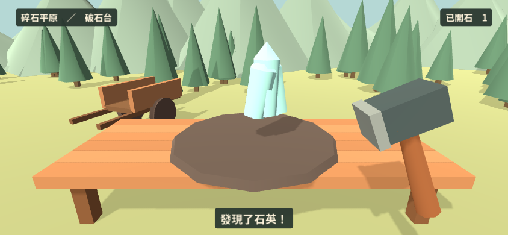

# 《石頭裡有什麼？》第一人稱實作方案

先交付一張能反覆敲石的工作台，再測玩家願不願意走第二趟運石。兩件事都成立，才值得花時間平衡產線。手機橫向與桌機從第一版共用同一套 3D 場景、物品結果與驗收路徑。V0.2 已可從採石區運石到工作台，V0.1 可獨立試玩。[原型與啟動方式](../../../prototypes/one-more-rock/README.md)



## 從兩份規格落到玩家手上

| 需求來源 | 玩家實際看見或做到的事 | 首次驗證 |
|---|---|---|
| 增量通則的瞬間回饋 | 槌頭揮下、石殼受壓、石屑從接觸點飛出，裂紋逐次增加 | V0.1 每一擊 |
| 隨機回饋與主動發現 | 殼內物品在原石出現時決定。最後一條裂縫顯出礦物色，玩家可先猜再敲。往後可去指定礦脈找對應原石 | V0.1 線索，M3 保底 |
| 能力質變 | 拎一袋變成推一車；站著敲變成把一批交給機器，自己回礦場 | V0.2 → V0.3 |
| 雜亂與清空 | 待處理的原石大量散落、堆疊、會滾會飛；玩家一邊升級一邊把整堆清空，清空時有收尾回饋，下一批更大 | V0.2 卸貨石堆，M4 爆量 |
| 世界觀驚喜 | 碎石平原出現第一件異常化石，紫晶洞窟的巨型晶洞成為第二個目標。後續世界各引入一種新的加工或搬運能力 | M5，後續擴充 |
| 專案規格 §2、5、6 | 走到礦點取得未知原石，運回同場工坊，開石後才看見名稱與用途 | M2–M3 |
| 本次平台與視角 | 透視 Camera3D，第一人稱看見工具；站上工作台時固定視角。野外開放雙指移動與看向 | M1 定點，M2 移動 |

增量通則互動示意的「超稀有 8× 掉落倍率」只供展示，專案規格的六階稀有度是未平衡的初始權重，V0.1 的四種結果是手感測試樣本，三者用途不同。V0.1 首顆必出石英，教會玩家揭露的樣子。V0.1 有四種結果：碎石 55%（2 幣）、石英 25%（8 幣）、方解石 14%（15 幣）、紫水晶 6%（60 幣），敲擊會提高估值，敲開後再點一次收走才入帳，稀有物有獨立演出。所以 V0.1 能初步看到「想等下一顆稀有」的驅動，但金幣還不能花，完整的抽獎與經濟驅動要到 M3 才量得到。正式掉落表到 M3 才依地圖和原石拆分。[增量通則](../spec.md) · [原石遊戲規格 §7、22–24](spec.md)

## 可玩的三個原型

| 版本 | 場景、操作與交付物 | 試玩問題與通過條件 |
|---|---|---|
| V0.1 破石台，已實作，試玩前待補 | 固定視點；可快速連點石殼，五擊敲開，三段裂紋依序出現，碎屑飛散。殼內是碎石、石英、方解石或稀有紫水晶，逐擊浮出估值差額；紫水晶有旋轉、專屬音效及震動。礦物留在檯面，點擊可立即收走，長按約 0.55 秒會自動收走，播放移礦與入帳後補石。首次發現與成就會顯示通知。最後一道裂縫對礦物發光，碎石也有 30% 會發光。推車在桌旁作為尺度參照。已補：命中停頓、隨機音高、第五擊加重。試玩前仍待補：石殼碎成碎片飛散、第二階段的音色線索 | 邀 5 人各自試玩，含至少 2 位橫拿手機。只說「想停就停」，記自願開石數、停下理由及哪些線索看得懂。提案門檻為至少 3 人自願敲滿 20 顆，記錄是否達到規格的 20–30 顆目標。5 人樣本只作定性判斷。原生與網頁版分開記錄，手機瀏覽器的音效延遲會直接影響手感 |
| V0.2 搬運，已實作，待真人試玩 | 出生點到第一面可採岩壁約 10 公尺，步道保留通行淨空。手持十字鎬直接開採 36 個岩山岩體。僅受擊區域剪除原始外皮並沿 Voronoi 切面挖凹，失去支撐的上層區塊先傾斜落塵，再坍落碎裂。碎岩可拾取，再上浮入袋或裝車。踏入木屋旁的木製料斗標線後自動卸貨，形成石堆，走進木屋後從三種外形的原石逐顆加工。揮舞、命中、碎裂、出礦各有獨立音效。由接觸點裁開舊表面，凹口內露出的方解石或紫水晶可直接敲，使用 impactMining 與 crystal hit。普通採掘每擊掉 1 顆，礦震掉 2 顆。採下的含礦原石保留礦物和硬度 | 同一批 20 顆分別用背包和推車運；初始背包需要 4 趟，推車 1 趟。記第二趟開始前的停留、誤觸、找不到回程的次數；滿倉部分卸貨後總數守恆 |
| V0.3 增量，已有升級與自動化切片 | 工坊使用 Kenney Adventure 主題的八條天賦樹。左欄切換路線，右側顯示節點、前置與解鎖效果。另有出礦、拾取與體能路線，以及升級車斗。普通連敲也提高品相，金色時窗及偶發亮面提供額外加成。進階槌解鎖較硬原石，鋼製十字鎬可換裝長按電鑽。拾運機器人從地面搬普通原石入料斗，自動破石機獨立運作，從硬度 1 升到 3 並按礦物基價入帳。鑑定、販售選擇與存檔待實作 | 首次玩家 3 分鐘內完成一筆升級，能指出哪個動作改變；20 分鐘內啟用機器，回來時看見庫存變化。若都在等幣，把成本或首批產量調低再試 |

若 V0.1 提早停手，回看最後三顆的操作，區分「揭露太慢」「三種結果看完了」「打中沒有重量」。一次只改命中停頓、揭露時間或線索其中之一，重測同一段。V0.2 若回程無聊，先縮短路程與改善卸貨動作。新增礦物無法驗證搬運問題。若誤觸或迷路來自第一人稱雙搖桿本身，退路是改成點地面移動或固定視角切換，不在 M2 期間反覆調靈敏度。

## 第一人稱與手機橫向

```
野外自由操作 ── 靠近並操作工作台 ──→ 定點破石
     ↑                                 │
     └──── 離台，回到原站位與朝向 ─────┘
```

**V0.2 的視角決策。** 採用 3D 透視第一人稱，採石區與工坊同場。「野外自由走動」保留走近岩壁、看見推車裝滿、轉身找到工坊的體驗；「工位定點」提供可重複敲擊的中央觸區。這次試玩特別記錄手機上走動與尋路的挫折。若操作成本壓過搬運樂趣，先試點地面移動，再評估固定視角。

| 操作 | 桌機 | 橫向手機 | 實作約束 |
|---|---|---|---|
| 工作台敲擊 | 點石頭本體 | 直接點石頭本體 | Camera3D 從觸點投射射線到石殼；點背景無效果。槌面對準射線命中點後，從接觸處噴出石屑。揭露後須再點一次，礦物先移至收料盤，入帳後才補石。玩家可以快速連點，兩擊最短間隔 0.09 秒，新的一擊會打斷上一次揮槌。破石成長改由每擊力量與原石耐久表現，不限制點擊頻率 |
| 野外移動與視角 | WASD、鎖鼠移視角、Esc 釋放 | 左下浮動搖桿、右側空白拖曳看向 | 用 touch index 保存手指歸屬直到放開。右指位移超過暫定 10 個邏輯像素才算拖曳；跨左右半區仍由原控制器處理 |
| 拾取、卸貨 | 走近採下的普通礦塊或卸貨箱 | 同桌機 | 收取半徑 2.10 m，沿線需可通視，卸貨半徑 1.85 m。容量不足時保留石頭並提示，入庫時播放吸入動畫、聲音與數量提示 |
| 手動互動 | 準星指向近物，按 E | 準星對準近物，按右下情境鍵 | 接車、停車、採掘、稀有石拾取、升級和進台共用一鍵。左鍵揮鎬採掘，右下情境鍵對應觸控，推車中沒有其他手動目標時可停車。敲擊與互動距離 2.5 m；失焦、旋轉或切工位會取消長按 |
| 離台與選單 | Esc 返回 | 安全區內「離台／返回」 | 進台釋放游標、隱藏搖桿；出站保留進台前朝向。選單攔截觸控，關閉當幀不穿透採掘 |
| 舒適度 | 可調視角靈敏度 | 獨立雙軸靈敏度、左右手配置 | MVP 初始關閉頭部晃動；回饋集中於工具及石殼。震動與音量可分別關閉 |

V0.1 只有工作台操作。從 M2 起，以 16:9、19.5:9、4:3 橫向及有缺口裝置各走一次來回。將平台安全區轉成 viewport 邊距，按鈕最小觸區以 48 個邏輯像素起測；web 依可視尺寸配置，直拿時提示轉橫。驗收包含兩指同時移動與轉向、單指離開畫面、切背景恢復。用錄影確認操作區未遮住石殼和新發現名稱。

## 場景與狀態邊界

```
桌機／觸控 → 玩家控制器 → 拾取、卸貨、敲擊、購買
                                 ↓
                       庫存、原石與錢包交易 ← 10 Hz 設備模擬
                                 ↓
               狀態變更 signal → 場景、HUD、圖鑑
                                 └→ 存檔快照
```

| 里程碑 | 可編輯場景或資料 | 寫入責任與交接方式 |
|---|---|---|
| M1 | 現有 scenes/workbench.tscn、scenes/stone.tscn、workbench.gd | 工作台管理單顆狀態；石殼碰撞決定命中；揭露時發出 specimen_opened。場景內可調相機、工具、物品、碎屑與 HUD |
| M2 | 新增 quarry.tscn、player.tscn、cart.tscn、unload_zone.tscn；工坊與採集場先同場 | CharacterBody3D 控制移動。採集點交出原石 ID，Inventory 負責轉移；推車內 5 組裝載外觀依容量比例切換。卸貨動畫結束前禁重複輸入 |
| M3 | data/items、rocks、loot、upgrades 下的 .tres；加工台接入庫存；販售與升級各一個面板；工作台旁的展示架 | 定義保存 ID、基價、模型、權重與硬度。玩家拾取與搬運的原石逐顆保存實例 ID、定義 ID、來源、預選結果、品質與剩餘耐久。圖鑑只聽成功揭露，錢包只聽成功販售。保留的首件立刻放上展示架，避免玩家只看到東西消失 |
| M4 | 固定採集機、運輸車、破石機、分類販賣站場景；每台顯示狀態與緩衝量 | 中央模擬擁有設備啟用狀態、進度與輸出庫存，世界場景只顯示抽樣結果。玩家與機器使用同一組轉移／揭露函式。設備流水線上的原石只記定義與數量，揭露時以存檔中的種子加計數器決定結果，讀檔同樣不重抽，存檔大小也不隨產量成長 |
| M5–M6 | MapDefinition、MapState、collection.tscn、settings.tscn、offline_report.tscn | 地圖剩餘量、採集率、收藏率、遺物復原分開保存。切換地圖後舊場設備仍由模擬管理；圖鑑可查來源、次數、最高品質與最大尺寸 |

**交易順序。** 每次轉移先查「原石仍屬於來源」及目的空位；一次修改兩端，再送 signal。舉例，倉庫 28/30、推車 5 顆，卸貨後倉庫 30、車上 3。第五擊把 PROCESSING 改為 REVEALED，將產物入帳一次，然後播動畫。重送事件、動畫中存讀檔、自動與手動同時碰到最後一顆，都用這個狀態拒絕第二次獎勵。

**從樣品台接上產線。** V0.1 的樣品來源無限。M2 接手時把「領取下一顆」改為從倉庫取一筆 STORED，缺料顯示空台。V0.2 逐擊顯示估值，揭露時記錄首次圖鑑與成就。礦物收走時只結算一次，播放入帳音效與錢包滾動，再領下一顆。已接入當次遊玩的實體圖鑑架，第一份收料後展示代表樣本。M3 接入預選結果、完整首件保留政策與持久化圖鑑。以固定種子做穩定案例，驗證不同操作順序、讀檔與機器加工都揭露同一件。每階段保留獨立試玩入口或版本標籤，方便回看純破石手感。

**雜亂與清空。** 增量通則要求待處理的東西多、亂、符合物理，玩家邊升級邊清空。物理只負責「看起來亂」；數量以帳本為準，處理動作要寬容。畫面分三層，玩家越靠近、越要動手的東西，物理越真：

```
近層：正在處理的那堆     真剛體 RigidBody3D，會滾、會彈、會被敲飛
  ↑ 玩家靠近或開始處理時，從堆表面剝下幾顆變成真剛體
中層：超出剛體上限的石頭  MultiMesh 沿預算好的拋物線／滾落路徑移動，落地後凍結
  ↑ 數量再增加
遠層：爆量的庫存         石堆或礦山模型，高度隨數量升降，不畫個別石頭
```

- **剛體上限。** 近層活躍剛體暫定手機 60、桌機 200，靜止即睡眠；超出的新石頭走中層。V0.2 的卸貨石堆先量手機網頁版的實際上限再定案。
- **帳本為準。** 剛體只是表現。飛出邊界、卡進縫隙或被回收的石頭不影響庫存數；掉出可及範圍就滾回或併入最近的堆，不讓稀有石掉進拿不到的地方。
- **亂而不刁難。** 卸貨箱與工作台有擋邊或漏斗，石頭會往玩家手邊滾；連點、按住、掃過都能一次處理多顆，動畫不擋輸入。
- **量級跳躍。** 數量指數成長，但畫面顆數有上限，所以每次能力質變都放大處理單位：一顆 → 一袋 → 一車 → 一斗。畫面顆數維持在預算內，每顆代表的量變大，玩家仍看得到「一大堆」。
**V0.2 已接入卸貨與破石。** 料斗中的石頭用剛體落下、互相碰撞，工作台領料時從堆表面取走並讓相鄰石頭重新滑落。敲石可連點、按住或掃入敲擊區。先購買背包，再以 40 幣購買重槌和加大料斗，原石由五擊降為三擊、料斗由 30 增為 60。清完整批有文字和音效。測試用 300 顆驗證近、中、遠層分配，M4 再以自動化吞吐及真機效能驗收。

- **清空回報。** 整堆清空、倉庫見底時有收尾演出與音效；下一批明顯更大。試玩時記玩家是否主動想把整堆清完，以及清完後是否立刻回去採下一批。

## 數值、經濟與產線

- **起始手感。** M2 步行 4 m/s、跑步 7.2 m/s，兩平台可跳躍。岩山使用 0.68–0.92 m 岩材單元。初始十字鎬按住每秒揮兩次；35 幣的鋼製十字鎬擴大單擊移除範圍。背包初始 5 格，25 幣升到 10 格；推車 20 格。收取先保留容量，落下後才入帳，滿載時礦塊留在岩腳。出生點到第一面可採岩壁約 10 m，試玩量測往返手感。
- **第一筆購買。** M3 起始金幣 0。首次石英保留展示品；後續一般礦暫售 8 幣，4 件重複品足以買 25 幣升級。售價依稀有度分級，M3 與掉落表一起定表。推車是 10 分鐘內的操作質變，M3 決定它的取得方式與價格，列入首批可買項目。第 L 級下一次價格取 floor(25 × 1.18^L)，首三次為 25、29、34。力量 1→2 時，5 耐久原石從 5 擊減至 3 擊。鑑定升級先顯示原石線索，逐步增加尋找特定收藏的能力。
- **驚喜與保底。** M3 逐張掉落表按正權重抽選；每張表都有基本項目。保底沿用取得時預選：連續未抽中稀有達門檻時，下一顆合資格原石預留稀有結果，取得時更新計數並保存。門檻由 10–15 分鐘首稀有目標反推，以 M2 實測的取得速度換算，暫估 60–100 顆；若用 10 顆，約 2–4 分鐘就會觸發。設備採集的原石另計，不消耗玩家的保底。異常化石另設可辨識的沉積岩點，讓玩家能主動追索。
- **原料與成品。** 首件自動登錄並保留展示品；玩家只出售可售數量。材料先入庫、異常物品保留、稀有重複品依設定。交易先確認持有數量與價格，扣貨加錢一次完成。批量結果用摘要顯示，首次或特殊發現才有完整演出。
- **設備。** 10 Hz 固定步長累積進度，每幀暫限 4 tick，前景積壓分幀處理，背景時間單獨結算。採集→運輸→加工→分類。每階段先算可取量、工作能力及輸出空間，轉移三者最小值，滿倉保留原料並顯示「輸出已滿」。單位產出、採運加工分類為 10/8/3/6 顆每秒時，充足原料下穩態為 180 顆/分；升級加工至 5 後才會變為 300 顆/分。
- **量級對齊。** 10/8/3/6 是規格示意值，不能直接用。按每顆 8 幣，180 顆/分等於每分鐘 1,440 幣，一分鐘收入就能買到單項約第 24 級；採集機每分鐘 600 顆，也會很快挖空有限的地圖。M4 開工前依序定下：每張地圖的原石總量、各稀有度售價、設備價格，再反推設備速度與升級曲線，目標是挖空平原的時間長於一個 Session Loop（5–15 分鐘）。規格 §11.2 的有限資源與 §11.4 的舊圖持續產出互相矛盾，M5 前二選一：挖空後只產無限量的低階碎石，或要重勘才恢復產出。
- **手開的理由。** 規格 §2.3 要求後期仍保留手動價值。M4 起至少一類特殊原石只能親手開，設備遇到時先存放並提示玩家。
- **勘探。** M5 暫採平原首次採集率 80%＋T2 工具＋勘探費；費用以正常出售重複物能達成為準。首輪完成後重勘只刷新該地圖的可採資源、位置及事件；保留收藏、裝備、設備及地圖解鎖。解鎖費不得造成地圖採空後無法重勘或前進。
- **存檔。** M3 先存版本、地圖剩餘量、各庫存 ID、預選結果、加工中耐久、保底、金錢與升級。M4 加設備與緩衝，M5 加勘探及收藏。用 Godot Kit atomic_file 寫入完整快照，載入按版本遷移；未知較新版本保留原檔。回前景時以 max(0, 現在－上次結算) 計算，上限 8 小時，僅啟用設備可運作。批次推進到下一個缺料、滿倉或耗盡事件；在一次存檔中同時提交產出和新時間戳，再顯示摘要。連開兩次存檔不能領兩次。
- **網頁版存檔。** iOS Safari 對未加入主畫面的網站，若 7 天沒有互動，會清除該站的 IndexedDB，Godot 網頁版的 user:// 就存在這裡。放置遊戲的玩家常隔週才回來，所以網頁版要提示加入主畫面，並提供匯出／匯入存檔。網頁的檔案系統是非同步寫回 IndexedDB，「斷寫檔」測試要在網頁版另跑一次，不能沿用桌機結果。

## V0.3 自動化切片

`quarry_automation.gd` 負責拾運和破石。拾運機器人只在待命時找落穩且可飛抵的普通原石，使用短距離射線選擇有淨空的航線，抵達才重新確認原石存在與料斗有位。一顆在途原石占用一格料斗保留位，防止玩家卸貨和機器人搶同一個空位。完成投料後才加入庫存，並沿用卸貨石堆的物理入料。固定式破石機以壓頭加工。自動破石從庫存擇取可處理的第一筆原石，完成後用共用掉落表按基價入帳。破石機先支援硬度 1，鍛鋼、鑽尖兩級各擴充一級。兩台的開關互相獨立。

## 六個里程碑與工期

沿用原規格的單人 12 週作為估算，每階段兩週。先完成上一階段右欄的路徑再投入下一批內容；週數隨真機與試玩結果調整。V0.1 與 V0.2 均已有可玩版本，真人驗收留待試玩。

| 階段 | 前置與兩週內的實作順序 | 出場驗收 |
|---|---|---|
| M1，第 1–2 週：破石手感 | 建工作台與首顆原石 → 對準觸點敲擊 → 調整裂紋、聲音、碎屑與揭露間隔 → 上橫向手機 | 5 擊、3 階段、4 種結果與售價、快速連點、點擊收料後補石通過；補齊碎片飛散後，記錄 V0.1 自願開石測試與真機回饋（原生與網頁分開） |
| M2，第 3–4 週：採集與搬運 | M1 通過後，做平原環路與第一人稱走跑跳 → 可挖岩體、Voronoi 坍落與四種採礦音效 → 背包、推車與部分卸貨 → 木屋旁屯石與室內破石 | 玩家能在手機雙拇指操作下完成「採一袋→回程→卸貨→開石」；驗證遮擋、容量、耗盡、誤觸與車上殘量；揮空只觸發風切，成功採掘依序播放命中、碎裂、出礦。已有 Godot 回歸，手機真機試玩待做 |
| M3，第 5–6 週：經濟切片 | 有完整手動路徑後，先定地圖總量、售價表與保底門檻 → 接資料表 → 販售／收藏 → 八路天賦與容量平衡 → 拾運與三階自動破石原型 → 保存交易和加工中狀態 | V0.3 可玩；首互動 5 秒、首開石 30 秒、首幣 60 秒、首升級 3 分鐘、操作改變 10 分鐘、首機器 20 分鐘作為試玩目標；讀檔後不重抽，資金不足不扣款；保留的首件在展示架可見；驗證滿倉阻塞、在途保留位、分級硬度及一次結算。拾運與分級加工原型已接入，持久化及定價試玩待做 |
| M4，第 7–8 週：完整產線 | 把拾運與破石接中央 tick → 加採集機、固定路線運輸與分類販賣站 → 設備面板顯示缺料／阻塞 → 與玩家操作交錯測試 | 預熱後量一分鐘吞吐，對照瓶頸公式；堵住輸出，解除後恢復，庫存與金錢可對帳；離開工坊一分鐘後同樣成立；只能手開的特殊原石會被設備存放並提示 |
| M5，第 9–10 週：紫晶洞窟與收藏 | 平原勘探門檻 → 紫晶洞窟與巨型晶洞 → 補滿物品、工具與收藏內容 → 重勘與舊區生產 → 特殊發現演出 | 約第 30 分鐘能進第二圖；逐項跑內容清單，地圖、原石、收藏對應正確；收藏未滿仍可解鎖，重勘不清空工坊 |
| M6，第 11–12 週：可交付 MVP | 接離線結算、遷移與設定 → 兩張地圖連續跑 30–60 分鐘 → 實機量冷／熱機、背景恢復與視覺負載 → 依實測調成本與畫質 | 完成兩平台完整循環；8 小時與逾限、倒撥時鐘、斷寫檔（桌機與網頁各一次）均有結果；iOS 網頁版的存檔匯出與加入主畫面提示可用；真機驗證下方效能預算；人工驗收後跑整套回歸 |

**M5 內容配額提案。** 以原規格的兩圖、6 種原石、24 件收藏、8 件工具、4 台設備為驗收清單。以下分配供製作排程；三種原型樣品可重用。

| 地圖／原石 | 物品表（每組四個不同 ID） | 讓玩家能辨認的線索 |
|---|---|---|
| 平原／石灰岩 | 方解石、石英、白雲石、霰石 | 淺色表面、粉筆般短促的敲聲 |
| 平原／沉積原石 | 菊石、貝殼化石、蕨印化石、異常化石 | 層理與螺旋紋 |
| 平原／金屬原石 | 自然銅、黃鐵礦、赤鐵礦、孔雀石 | 帶鏽斑、尾音偏金屬 |
| 洞窟／晶洞原石 | 紫水晶、瑪瑙、玉髓、螢石 | 空心共鳴與紫色光隙 |
| 洞窟／脈石 | 煙晶、黃水晶、薔薇石英、重晶石 | 長條晶脈與密集反光 |
| 洞窟／巨型晶洞 | 雙尖晶簇、葡萄狀瑪瑙、雙色螢石、星形晶核 | 體積大，需推車與高階槌 |

8 件可操作工具按工作分配為採集 3 件（石鎬、鐵鎬、電鑽）、搬運 2 件（背包、手推車）、加工 3 件（手槌、重槌、晶洞切割機）。4 台固定設備為自動採集機、運輸礦車、自動破石機、分類販賣站；分類規則由販賣站執行。開發以固定插槽與路線控制範圍。MVP 後才逐區提案失落荒漠至星辰彼端；每區需有一項能實際操作的新能力，例如復原雷神之鎚後才解鎖連鎖破碎。

## 效能、驗證與交付判斷

**量測場景。** 在正常破石台、滿車卸貨、四設備同時運作三個位置留固定視角。手機先測 30 FPS（每幀 33.3 ms），桌機測 60 FPS（16.7 ms）；記裝置、解析度、畫質、冷啟動耗時、連跑 10 分鐘後的中位數及 p95 frame time。初始壓測量採手機／桌機碎片 40／120、可見輸送石 100／300、礦石 500／2,000、邏輯設備 100／500。邏輯與畫面各自量；剛體只用在近層，依上一節的三層表現分配，數百顆以上的礦石走 MultiMesh 或石堆模型。

**降載順序。** 靜態礦點用 MultiMesh，近距石殼才掛互動碰撞。超過預算時先調降近層剛體上限，把多出的石頭交給中層，不砍數量。碎片到壽命即回收，遠處設備用低頻動畫。先降碎片、陰影與可見輸送樣本，再調整渲染尺度；帳本的採集與加工數量維持一致。HUD 依事件或每秒 5–10 次更新。

| 層級 | 何時跑 | 最小證據 |
|---|---|---|
| L1 | 修改價格、掉落、保底、倉庫或離線算式 | 固定輸入所得的價格、保底邊界、剩餘量及金額完全吻合；同一份快照重載結果相同 |
| L2 | 輸入、場景、工坊與模擬串接 | headless 匯入及受影響路徑；M1 的滑鼠／觸控循環入口見原型 README。M2 起另走一次採集→卸貨→加工→售出，錄到阻塞與恢復 |
| L3 | MVP 跨系統封版 | 人工試玩完成後跑全回歸；留初始／滿倉／加工中／舊版本存檔，對照 30–60 分鐘路線、兩台實機和資料遷移 |

首次試玩記錄用一張表即可：裝置與橫向尺寸、首次命中／首次揭露／售出／升級／自動化／進第二圖的時間、自願開石數、第一次迷路或誤觸的位置、停止原因。每一個超出目標的時間都要對回當時的操作或瓶頸；玩家能在 30 秒內開石和玩家願意再敲第 20 顆，是兩個分開判定的結果。
