核心循環

敲擊石頭

碎裂、發現物品
寶石／化石／神祕物體
販售或收藏

升級工具
力量、連鎖敲擊、發現能力
解鎖更神祕的石頭

重新循環

甚至可以讓玩家根據石頭的外觀、敲擊聲音、裂縫透出的光芒，提前猜測裡面藏了什麼。

這會比單純的隨機掉落多一層期待感。

《石頭裡有什麼？》
What's Inside the Rock?
Game Design Document — v0.101. Game Overview｜遊戲總覽
1.1 基礎設定
項目	規格
遊戲名稱	石頭裡有什麼？（暫定）
英文名稱	What's Inside the Rock?
遊戲類型	Incremental、Cozy、Automation、Collection
遊戲引擎	Godot 4.x
遊戲模式	單人遊戲
美術形式	2D／2.5D／3D，尚未定案
目標平台	PC / Steam，保留手機移植可能
遊戲節奏	輕鬆、無時間壓力
核心體驗	採集、挖掘、搬運、破石、發現、收藏、自動化
失敗懲罰	無
網路需求	初版完全離線
開發規模	單人獨立開發

1.2 遊戲概念
玩家從一名普通的採石者開始，手上只有簡陋的工具。

透過探索不同地圖、挖掘岩石、收集原石，將這些未知的石頭搬回自己的工坊，親手敲開並發現其中的物品。

石頭內部可能包含普通礦物、水晶、寶石、化石、古代遺物，甚至是修仙世界的法寶、北歐神話的神器碎片。

玩家可以販售物品取得金錢，升級自己的裝備與設備，逐漸建立自動化採集、運輸、加工及販售流水線。

隨著遊戲進度推進，玩家探索的地圖逐漸從真實世界延伸至神話世界及其他次元。
1.3 核心設計支柱
設計支柱	設計目標
Discovery 探索	永遠不知道下一顆石頭裡有什麼
Satisfaction 療癒	每一次挖掘、卸貨與敲擊都有感官回饋
Progression 成長	原本需要一分鐘的工作，後期一秒完成
Automation 自動化	將手動操作逐步轉換成自動流水線
Collection 收藏	收集來自不同世界的珍奇物品
Relaxation 放鬆	不強迫玩家追求最高效率，沒有失敗壓力

1.4 玩家身份的成長

普通採石者
徒手收集石頭，使用簡陋工具

礦物商人
搬運大量原石，販售寶石與水晶

工坊經營者
建立自動化採集與加工產線

神話考古學家
發掘靈石、法寶與神話遺物

跨次元收藏家
開採其他世界的未知物質

02. Core Gameplay Loop｜核心遊戲循環
2.1 主要遊戲循環
探索地圖
尋找石頭、岩石堆與礦脈

挖掘採集
取得尚未鑑定的原石

搬運原石
使用背包、推車、礦車

卸貨儲存
將原石運送至工坊倉庫

破石加工
敲擊、切割、粉碎原石

發現未知物品
水晶、寶石、法寶、神器

販售或收藏
取得金錢與收藏進度

升級裝備及設備
提高效率、解鎖自動化與新地圖

↻ 解鎖新能力後重新進入循環
2.2 不同時間尺度的遊戲循環
循環	時間尺度	玩家行為
Micro Loop	1–10 秒	挖掘、拾取、敲擊、發現物品
Short Loop	1–3 分鐘	採集一批石頭並運回工坊
Session Loop	5–15 分鐘	加工、販售、購買裝備
Progression Loop	30–90 分鐘	完成地圖、解鎖新區域
Long-term Loop	數小時以上	完成收藏、自動化、復原神器

2.3 遊戲成長原則
遊戲中的所有工作，一開始都需要玩家親自完成，但最終都可以被自動化。
初期操作	中期操作	後期操作
徒手拾取	自動拾取	範圍吸收
手動挖掘	電動鑽頭	全區域自動開採
背包搬運	礦車搬運	空間傳送
手動敲石	自動破碎機	批量煉化
手動販售	自動分類	自動販售
單一地圖	多區域開採	跨世界產線

但手動操作不應完全失去價值。後期玩家仍然可以親自處理特殊原石、觀察稀有物品，或者尋找自動採礦機無法發現的特殊資源。
03. World Design｜世界與地圖設計
3.1 基礎場景配置
遊戲主要由採集區及加工工坊構成。

初期採集區及工坊可以位於同一場景，避免頻繁讀取與切換地圖。

後期不同世界共用同一個主要工坊，各地圖則擁有自己的採集設備與運輸路線。

3.2 地圖設計原則
每張地圖具備以下特性：
- 獨立的地質、環境及美術風格。
- 不同種類的原石與礦脈。
- 獨立掉落表及稀有收藏。
- 有限的初始資源及採集完成度。
- 專屬的特殊事件與隱藏物品。
- 對應的工具等級及設備需求。
- 完成後可以重新勘探。
- 可以建立自動化採集據點。
3.3 地圖內容規劃

Map 01｜碎石平原

地質：石灰岩、沉積岩。

產物：石英、方解石、普通化石。

特色：初始教學區域，大量石頭可以直接拾取。

Map 02｜紫晶洞窟

地質：火成岩、晶洞。

產物：紫水晶、瑪瑙、玉髓、螢石。

特色：高價值水晶及大型原石。

Map 03｜失落荒漠

地質：砂岩、沉積地層。

產物：化石、古代錢幣、琥珀、文明遺物。

特色：收集碎片並復原古代文物。

Map 04｜熔岩深淵

地質：玄武岩、黑曜石、火山岩。

產物：橄欖石、黑曜石、火元素結晶。

特色：需要更高階的開採與破碎設備。

Map 05｜上古靈脈

世界觀：東方修仙。

產物：下品靈石、上品靈石、仙玉、飛劍、法寶碎片。

特色：解鎖靈力採集、御物搬運、煉化設備。

Map 06｜諸神遺跡

世界觀：北歐神話。

產物：神鐵、盧恩符石、世界樹琥珀、雷神之鎚碎片。

特色：神話級工具與雷電連鎖加工。

Map 07｜奧林帕斯殘界

世界觀：希臘神話。

產物：泰坦之骨、神火、宙斯雷霆碎片。

特色：巨型原石及神明遺物。

Map 08｜星辰彼端

世界觀：宇宙及異次元。

產物：星核、時空結晶、微型宇宙。

特色：反重力採集、跨次元運輸、空間分離設備。

以上八張地圖屬於長期內容規劃，MVP 只需要完成前兩張。地質與礦物配置以遊戲趣味為優先，不追求完全符合現實地質學。
04. Mining System｜採集與挖掘系統
4.1 可採集物件
類型	取得方式	特性
散落石頭	直接拾取	初期主要資源
岩石堆	挖掘、敲擊	一次產出多顆原石
地下礦石	挖掘土壤	必須先發現位置
礦脈	持續開採	適合大量生產
巨型原石	特殊工具	高價值，需要大型運輸設備
異常原石	隨機發現	可能藏有特殊物品
神話原石	特殊地圖	法寶及神器來源

4.2 採集操作流程
玩家對岩石進行點擊或長按操作，依照工具的力量與速度消耗礦石耐久度。

耐久度歸零時，岩石破碎並掉落數顆尚未鑑定的原石。

採集過程不會直接揭露所有內部物品，保留後續加工的期待感。

### V0.2 採石場實作

玩家以第一人稱探索碎石平原，桌機可走、跑、跳，手機使用橫向觸控。按左鍵或右下情境鍵揮十字鎬，按住可連續挖。玩家從出生點走約 10 公尺就能敲到岩壁，步道保持淨空。岩山可直接挖出凹洞，首擊保留岩山原始輪廓，挖到的區域剪去岩石外皮與懸空薄片，再補預烘焙 Voronoi 切面，碰撞跟著更新。岩層失去支撐後先落塵傾斜約半秒，再受重力落下並碎裂。每擊只重建受影響的切面，坍落剛體上限為手機 4、桌機 8。十字鎬抬鎬、落鎬、短停後收回，連挖預設每 0.56 秒一次。第三階工具電鑽按住會持續向前鑽掘。右鍵或手機礦震鍵可蓄力大範圍採掘，冷卻 8 秒。

| 採礦音效 | 觸發時機 | 聲音辨識 |
|---|---|---|
| 十字鎬揮舞 | 抬鎬結束並開始劈下 | 短風切，揮空也會播放 |
| 鎬頭敲到岩石 | 鎬尖實際命中碰撞點 | 短促硬撞擊，音高輕微變化 |
| 岩石碎裂 | 成功切除岩材後約 45 ms | 連續碎裂聲，配合石屑；大型坍落另有落地聲 |
| 成功挖出原石 | 普通原石出現後約 130 ms，每擊一次 | 出礦短音階 |
| 命中露出的方解石或紫水晶 | 礦片本體受到直接敲擊或鑽掘 | impactMining 硬撞擊疊上 crystal hit 共鳴 |

一般揮鎬與電鑽每次成功採掘掉 1 顆原石，礦震掉 2 顆。出礦天賦額外增加 1 或 2 顆。連續坍落的岩塊共用出礦間隔，單批最多 2 顆。步行和跑步依實際位移播放砂礫腳步，電鑽按住時播放循環馬達聲。凹口可露出可單獨採掘的方解石與紫水晶。採下後掉一顆可手動拾取的含礦原石，送到工坊後保留對應礦物與硬度。收走工坊成品時播放金幣入帳。

4.3 採集屬性
屬性	說明
Mining Power	每次挖掘造成的傷害
Mining Speed	每秒挖掘次數
Mining Range	可開採的範圍
Mining Yield	額外原石產量
Critical Chance	挖掘暴擊機率
Tool Tier	可開採的岩石硬度等級
Auto Mining	自動開採能力

4.4 工具發展
Tier	工具	特殊能力
T0	徒手	拾取散落石頭
T1	石鎬	開採普通岩石
T2	鐵鎬	高力量與速度
T3	電動鑽頭	持續性挖掘
T4	工業採礦機	範圍開採
T5	靈力飛劍	遠距離多目標採集
T6	神話之鎚	大規模連鎖破壞
T7	空間採集器	分離整片礦脈

重點不是工具數值，而是工具升級後，玩家實際操作的方式也會改變。
05. Transportation System｜搬運與物流系統
搬運是遊戲的重要環節，不能只做成背包數字。

玩家應該可以看到自己收集的石頭越來越多、推車逐漸裝滿，最後回到工坊將所有石頭傾倒出來。
5.1 搬運設備

徒手

1–3 顆

直接抱起石頭

背包

5–10 顆

攜帶小型原石

手推車

20–30 顆

大量石頭隨物理碰撞晃動

礦車

50–100 顆

固定路線批量搬運

輸送帶

持續輸送原石

御物術

大量原石漂浮跟隨玩家

乾坤袋

超大容量、壓縮原石

空間傳送

跨地圖瞬間配送

5.2 搬運相關屬性
屬性	說明
Carry Capacity	最大搬運數量
Weight Limit	最大搬運重量
Movement Speed	玩家移動速度
Pickup Radius	拾取範圍
Transport Speed	設備運輸速度
Auto Pickup	是否自動拾取
Auto Delivery	是否自動卸貨

初期只需要實作容量限制，不需要同時加入複雜的重量、體力與負重懲罰。
5.3 搬運與卸貨回饋
手推車裝載石頭時，可以實際看到石頭堆積；移動時產生輕微晃動及碰撞；抵達倉庫後，透過傾倒動畫將石頭全部卸下。

後期礦車及輸送帶持續運作，也會讓玩家感受到自己的工坊逐漸變得繁忙。
5.4 倉庫規則
- 倉庫擁有容量上限。
- 抵達卸貨區時可以一鍵或自動卸貨。
- 不需要手動整理每一顆石頭。
- 不同原石種類可以自動分類。
- 倉庫容量可升級。
- 倉庫滿載時暫停自動運輸。
- 已取得的原石不會因為容量不足而消失。
- 可以優先加工特定種類的原石。
06. Rock Processing System｜原石加工系統
這是整款遊戲最重要的機制。

玩家採集石頭是為了享受將石頭打開的那一刻，而不是單純獲取資源數字。
6.1 破石的四個階段

階段	回饋
完整	根據外觀猜測可能內容
初步受損	碎屑、敲擊聲、輕微裂痕
即將破碎	深層裂痕、發光、特殊聲音
完全破碎	物理碎片、物品揭露、收藏登錄

6.2 原石屬性
屬性	說明
ID	原石種類識別
Origin	來源地圖
Mining Hardness	採集硬度
Breaking Durability	加工耐久度
Size	原石大小
Weight	原石重量
Loot Table	對應掉落表
Quality	物品品質
Visual Variant	外觀變體
Reveal Hint	內部物品的提示
Seed	固定該顆原石的內容生成結果

建議在玩家取得原石時就決定內部內容，後續敲擊只是逐步揭露，這也能避免玩家透過反覆讀檔重新抽取物品。
6.3 原石分類
原石	可能的內部物品	特性
普通岩石	石英、低價礦物	加工容易
晶洞原石	紫晶、瑪瑙	具有空心共鳴
沉積原石	化石、古代遺物	不規則外觀
金屬原石	銅、金、銀	較高硬度
巨型原石	大型結晶、多件物品	高耐久、高價值
靈力原石	靈石、仙玉、法寶	靈氣發光
神話原石	神鐵、神器碎片	特殊符文與音效
異常原石	未知物品	不遵循一般規則

6.4 加工工具發展
Tier	工具	加工能力
T1	手槌	逐次敲擊
T2	重型槌	提高單次破壞力
T3	晶洞切割機	將原石切成兩半
T4	電動破石機	自動加工單顆
T5	多工位破碎機	同時加工多顆
T6	靈力煉化爐	批量分離礦物
T7	雷神之鎚	連鎖破碎
T8	空間分離器	大量瞬間揭露

6.5 加工模式
不同工具可以帶來不同的操作體驗。

手槌著重敲擊與裂痕；切割機著重整齊切面及水晶露出的瞬間；破碎機著重大量連續加工；煉化爐則可以將大量原石轉化成漂浮的靈石或法寶。

不建議加入操作失敗導致稀有物品永久損壞的機制，避免與輕鬆向定位衝突。
07. Loot & Discovery｜掉落與驚喜系統
7.1 物品稀有度

普通 Common

60%

非凡 Uncommon

25%

稀有 Rare

10%

史詩 Epic

4%

傳說 Legendary

0.9%

神話 Mythic

0.1%

初始掉落權重示意，尚未經過經濟平衡測試。
每張地圖及每種原石都擁有自己的掉落表，不能單純透過稀有度決定物品。

例如初始地圖的神話級物品可能是一顆異常化石，而北歐地圖的神話級物品則可能是世界樹核心。
7.2 物品分類與用途
分類	範例	用途
普通礦物	石英、方解石	販售
金屬	銅、銀、金	販售、設備升級
水晶寶石	紫晶、祖母綠	收藏、販售
化石	菊石、恐龍牙齒	收藏、復原
古代遺物	錢幣、雕像	收藏
靈石	下品至極品靈石	特殊升級
法寶	飛劍、乾坤袋	特殊能力
神話碎片	雷神之鎚碎片	神器復原
異常物品	微型世界、未知生物	隱藏事件

7.3 特殊驚喜事件
除了物品本身的稀有度之外，還需要設計特殊發現事件。
事件	效果
石中之石	敲開後出現另一顆更稀有的原石
水晶爆發	一顆原石掉落大量水晶
金幣瀑布	大量金幣從原石內湧出
石頭精靈	解放藏在石頭裡的生物
遠古封印	敲開後觸發隱藏遺物事件
異世界裂縫	提前發現其他世界的碎片
巨型寶石	揭露遠超正常尺寸的寶石
異常原石	內部出現不符合物理規則的物品
連鎖共鳴	附近的原石同時開始破碎

這些事件的目的，是避免玩家在熟悉基本掉落規律後，遊戲就失去驚喜。
7.4 物品品質與尺寸
同一種類的水晶不一定具有完全相同的價值。

建議加入簡單的品質或尺寸變化，讓重複發現同一種物品仍然可能令人興奮。
品質	價值倍率範例
普通	1×
優良	1.5×
完美	3×
巨型	5×
異常	10× 以上

品質系統不需要在 MVP 同時加入太多隨機詞綴，優先透過外觀、尺寸及價值差異呈現。
7.5 神器與法寶復原
玩家在特殊地圖中可以取得神器碎片，集齊指定種類後復原完整神器。
比如雷神之槌 = 垂頭 + 神鐵 + 握柄 + 雷霆核心
神器復原後的能力範例

破石力量提升、雷電連鎖、範圍破碎，並解鎖神話級設備。

法寶／神器	效果
飛劍	自動採集周圍礦石
乾坤袋	大幅增加搬運容量
聚寶盆	增加額外物品產出
煉丹爐	批量煉化原石
雷神之鎚	大範圍連鎖破碎
世界樹根鬚	增加礦脈再生效率
盧恩符石	強化設備能力
時空結晶	提升生產速度
空間核心	跨地圖自動運輸

神器應該帶來能力質變，而不是單純提高販售價格。
08. Economy & Progression｜經濟與增量成長
8.1 貨幣系統
資源	取得方式	用途
金幣	販售物品	一般裝備及設備升級
靈石	修仙地圖	靈力設備、法寶升級
神性碎片	神話地圖	神器與神話設備
星辰核心	宇宙地圖	終局設備

初期只需要金幣，不應太早加入多種貨幣。
8.2 升級分類
類型	可升級項目
採集	力量、速度、範圍、產量
搬運	容量、移動速度、拾取範圍
加工	破石力量、速度、同時加工數量
鑑定	稀有物品機率、額外產出
倉庫	容量、分類效率
自動化	設備數量、設備吞吐量
經營	販售價格、離線收益

8.3 初始數值規劃
屬性	初始數值
玩家移動速度	4 單位／秒
挖掘力量	1
挖掘速度	2 次／秒
搬運容量	5 顆
倉庫容量	30 顆
破石力量	1
破石速度	2 次／秒
同時加工數量	1 顆
自動採集速度	0
自動搬運速度	0
自動加工速度	0

8.4 升級成本公式
升級成本使用指數成長：
\[
Cost(L)=\lfloor BaseCost \times GrowthRate^L\rfloor
\]

能力使用線性或分段成長：
\[
Power(L)=BasePower+L\times Growth
\]

例如基礎成本為 25 金幣，成本成長倍率為 1.18。

0 G1000 G2000 G3000 G4000 G051015202530

每隔一定等級應該安排一次重要機制升級，例如解鎖範圍挖掘或自動敲擊，而不是無限增加傷害數字。
8.5 經濟成長的核心
玩家需要持續改善產線中的瓶頸。
挖掘速度太慢

升級採礦工具

石頭太多，搬運速度不足

購買更大的搬運設備

倉庫堆滿，加工速度不足

購買自動破石機

產物太多，分類速度不足

解鎖自動分類與販售

進入更高階地圖

這就是增量遊戲的長期成長動力。
09. Automation System｜自動化流水線
9.1 自動化系統架構
自動踩 - 自動搬運 - 原石倉庫 -自動破石 -鑑定分類  - 自動販售 - 收藏展示 材料倉庫
9.2 自動化發展階段
階段	主要特性
Stage 1 手工作坊	玩家負責全部操作
Stage 2 半自動化	自動拾取、礦車、自動敲擊
Stage 3 工業化	採礦機、輸送帶、破碎機、分類機
Stage 4 靈力自動化	飛劍、乾坤袋、煉化爐
Stage 5 神話工坊	神器驅動設備、雷電連鎖加工
Stage 6 跨次元產線	跨世界傳送與大量同步開採

### V0.3 工坊自動化

| 天賦 | 花費 | 能力 |
|---|---:|---|
| 拾運機器人 | 55 幣 | 從採石場拾取已落穩的普通原石，一次一顆，運到小屋旁的料斗。 |
| 自動破石機 | 50 幣 | 從料斗取料，固定機台的壓頭下壓加工硬度 1 的原石。 |
| 鍛鋼破石機 | 80 幣 | 可加工硬度 2 的緻密原石，產出依硬度使用對應掉落表。 |
| 鑽尖破石機 | 125 幣 | 可加工硬度 3 的稀有原石，結算紫水晶基價。 |

四個天賦依序解鎖。拾運只取普通原石，玩家親手拾取的稀有原石也能卸貨入庫。機器人撿起時先保留一格料斗容量，放進料斗才增加庫存與石堆。滿倉時留在地上的石頭可由玩家處理。自動破石從同一料斗取第一顆符合硬度的原石，加工完成結算一次礦物基價。手動破石可獲得額外品相與圖鑑樣本。拾運、破石各自可暫停接單，已開始的工作會完成。此版本進度保存於本次遊玩。

9.3 產線吞吐量模擬
每個設備具有獨立的吞吐量，整體穩態產能取決於效率最低的環節。
自動化產線 Prototype
實際產量180
顆／分鐘
採礦產能利用率30%

採礦

10 顆／秒

搬運

8 顆／秒

破石
瓶頸

3 顆／秒

分類

6 顆／秒

優先升級：破石重置模擬此模擬假設一顆原石對應一份待分類物品，不計算暫存庫存及運輸延遲。
9.4 設備建造方式
建議初版採用固定設備位置及固定物流路線。
功能	MVP
固定設備位置	支援
設備升級	支援
設備數量增加	支援
固定路線礦車	支援
自動輸送帶	支援
自動分類	支援
自動販售	支援
自由建造工廠	暫不實作
自訂物流路線	暫不實作
電力系統	不實作
機器損壞及維修	不實作

遊戲可以有類似 Factorio 的流水線觀賞感，但不需要具備 Factorio 等級的工程管理複雜度。
9.5 自動分類規則
玩家可以設定物品取得後的處理方式。
物品條件	預設行為
首次發現	自動登錄圖鑑、保留展示品
普通重複物品	自動販售
稀有重複物品	依玩家設定
裝備升級材料	優先儲存
神話碎片	自動保留
未知異常物品	自動保留並提示

避免自動化導致玩家錯過珍貴物品，或不小心出售神器碎片。
10. Collection System｜收藏與博物館
收藏系統是除了經濟成長之外的第二條主要進度。

如果遊戲只有金錢與升級，玩家到後期可能會對物品失去興趣。因此，每一個稀有發現都應該在遊戲世界中留下紀錄。

13

10.1 博物館展區
展區	收藏內容
地質展區	岩石及普通礦物
水晶展區	水晶、寶石、晶洞
古生物展區	化石、恐龍骨架
古文明展區	錢幣、雕像、文明遺物
修仙展區	靈石、法寶、仙器
北歐神話展區	神鐵、盧恩符文、神器
希臘神話展區	神明遺物、泰坦碎片
異常收容區	未知物品、神祕生物
宇宙展區	星核、星辰碎片、微型世界

10.2 收藏圖鑑
碎石平原收藏圖鑑
已發現 6 / 12 種物品

50%

石英

方解石

紫水晶

黃鐵礦

菊石化石

綠螢石

未發現

未發現

未發現

未發現

未發現

未發現

收藏介面示意
10.3 物品收藏資訊
每件物品的圖鑑包含：
- 物品名稱及介紹。
- 外觀模型或圖片。
- 稀有度。
- 來源地圖及原石種類。
- 首次發現紀錄。
- 累計發現次數。
- 曾經發現的最大尺寸。
- 曾經發現的最高品質。
- 是否具有特殊能力。
如果最後採用 3D，可以讓玩家旋轉及放大收藏品，仔細欣賞水晶結構與神器細節。
10.4 收藏獎勵
地圖收藏完成度	獎勵範例
25%	採集效率提升
50%	地圖專屬裝飾
75%	特殊原石探測器
100%	專屬永久能力、收藏獎盃

不應強迫玩家完成全部收藏才能前往下一張地圖。

收藏是長期目標，不是阻擋主線成長的門檻。
11. Map Progression｜地圖進度與重玩機制
11.1 地圖的三種獨立進度
紫晶洞窟
採集完成度

86%

物品收藏度

65%

特殊遺物復原

25%

下一張地圖解鎖條件
採集完成度達到 80%

取得 T2 採礦工具

支付下一區域勘探費用

地圖解鎖條件建議以採集進度為主，不依賴隨機掉落。

你原本提出的想法是蒐集完整張地圖再進入下一張，因此也可以將採集完成度門檻設定為 100%。80% 是另一種較寬鬆的設計提案，兩者尚未定案。
11.2 地圖資源耗盡
每張地圖具有有限的初始資源。

當玩家持續挖掘，原本充滿石頭的地圖會逐漸變得空曠，讓玩家可以直接從畫面上感受到自己的進度。

地圖中也可以安排一顆特殊巨型原石作為最終採集目標。

例如：
地圖	最終採集目標
碎石平原	巨型地底岩石
紫晶洞窟	巨型紫晶洞
失落荒漠	封存遠古生物的化石岩
熔岩深淵	火山核心
上古靈脈	萬年靈石
諸神遺跡	神明封印石
奧林帕斯	泰坦遺骸
星辰彼端	破碎星核

這些最終原石不需要設計成 Boss 戰，而是需要玩家透過裝備、搬運與加工能力的累積，才能成功處理的巨大資源。
11.3 重新勘探機制
完成一張地圖後，玩家可以選擇重新勘探。

重新勘探將刷新礦石位置、資源數量及隨機特殊事件，但不會重置玩家裝備、首次採集完成紀錄、收藏圖鑑、已建立的永久設備或已解鎖的地圖。

這樣可以避免玩家因為錯過稀有物品，而永久無法完成收藏。
11.4 舊地圖持續產出
後期玩家可以在已完成的地圖設置自動化採集據點。

碎石平原 = 普通礦石 紫荊洞窟=水晶 上古靈脈 = 靈石 諸神遺跡=神話碎片 
然後都可以到
中央加工工坊 統一加工分類及販售

這讓舊地圖不會因為解鎖新地圖而失去價值。普通礦物仍然可以用來製作工業設備，而不同神話世界的材料也可以用於跨世界設備升級。
12. Game Feel｜操作手感與感官回饋
這款遊戲真正需要投入最多時間打磨的，不是地圖數量，也不是數值系統，而是石頭從完整到破碎，再到揭露內部物品的過程。

即使 Prototype 只有一張地圖、十種礦物，只要這個過程足夠有趣，就能驗證遊戲是否成立。
12.1 五種核心操作的回饋設計

挖掘 Mining
- 鎬子擊中岩石時產生短暫停頓。
- 石頭隨著耐久度逐漸產生裂痕。
- 不同岩石具有不同敲擊聲。
- 最後一擊產生大量碎屑與原石。

搬運 Transportation
- 推車內的石頭隨移動晃動。
- 裝載越多，視覺上越有份量。
- 卸貨時整批石頭傾瀉而出。
- 升級後能看到搬運規模明顯增加。

破石 Breaking
- 敲擊位置出現裂紋。
- 碎片隨著敲擊方向飛散。
- 接近破碎時，光芒從內部透出。
- 最後一擊帶有短暫慢動作與清脆的破裂聲。

揭露 Discovery
- 稀有物品出現時暫時突出顯示。
- 可以旋轉、觀察新發現的物品。
- 高稀有度使用專屬音效及粒子效果。
- 首次發現自動登錄收藏圖鑑。

自動化 Automation
- 原石持續經過輸送帶。
- 機器以不同節奏進行加工。
- 水晶依照分類結果流向不同設備。
- 大量販售時，金幣快速累積。

12.2 破石回饋時間軸
敲擊(可以根據稀有度分多次 要有音效 跟特效回饋) 撞擊 裂痕發光 碎裂  接露
一般原石應該能快速加工，只有首次發現或極為特殊的物品才播放較完整的揭露動畫。

否則當玩家每秒能破開數十顆石頭時，原本令人愉快的動畫就會變成阻礙。

12.3 不同材質的差異化體驗
材質	音效特徵	破壞效果
石灰岩	沉悶、乾燥	粉塵與小碎石
花崗岩	厚重撞擊	大型硬質碎片
晶洞	空心共鳴	外殼裂開、晶體露出
黑曜石	清脆尖銳	玻璃狀碎片
冰原石	清透碎裂	冰霧與半透明碎片
靈石	清脆鐘聲	靈氣流動、發光粒子
神鐵	金屬共鳴	火花、符文、震波
星辰原石	低頻空間音	重力扭曲、星塵

初版不需要為每種礦石製作完全不同的破壞系統。可以共用一套破碎邏輯，再透過 Material、Particle Preset、音效與 Shader 參數來表現不同材質。
13. Art Direction｜美術與 2D、3D 方案評估
這個專案可以採用四種主要視覺方案。由於破石、搬運及大量物件的呈現是核心體驗，我不會單純以製作成本決定。
方案 A｜2D Top-down Pixel Art

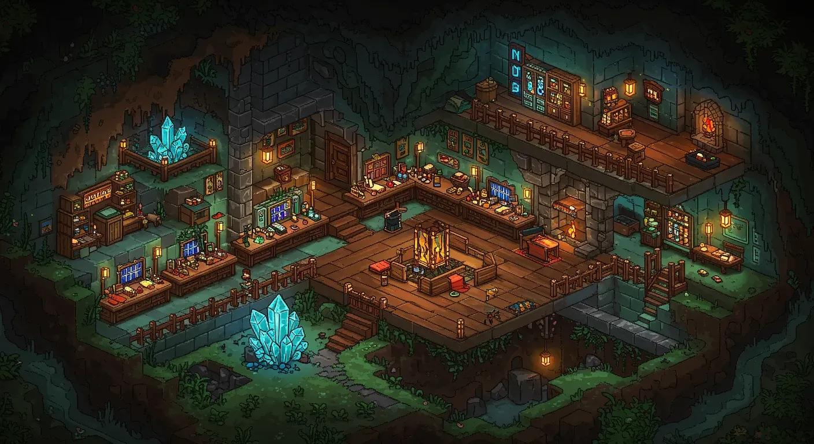
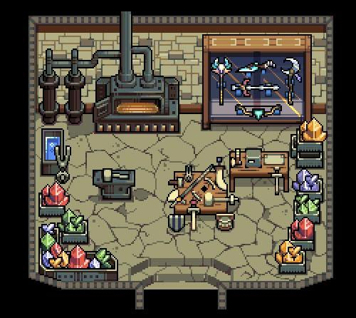

類似 Stardew Valley 的俯視操作，玩家控制角色在地圖移動、挖掘與搬運石頭。
項目	評估
開發成本	低至中
手機效能	優秀
地圖製作	容易
石頭破碎回饋	中等
物品收藏展示	中等
美術擴充性	高

缺點在於石頭的體積、材質及內部水晶比較難呈現。每種破碎效果可能需要繪製額外 Sprite 或動畫。
方案 B｜2D Isometric 插畫風格

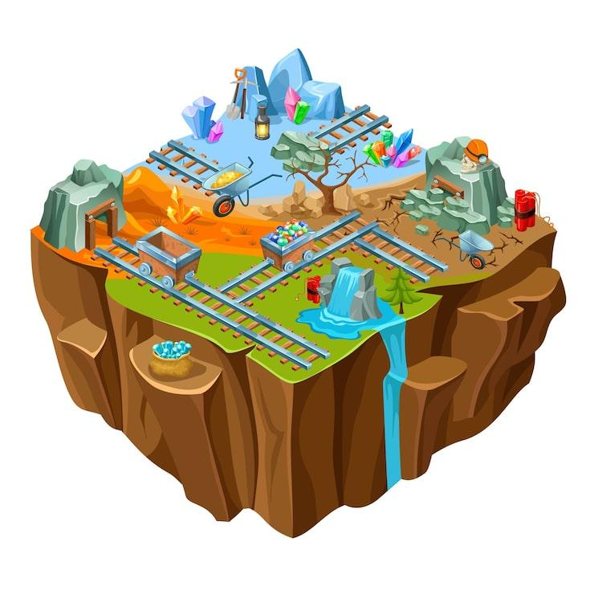

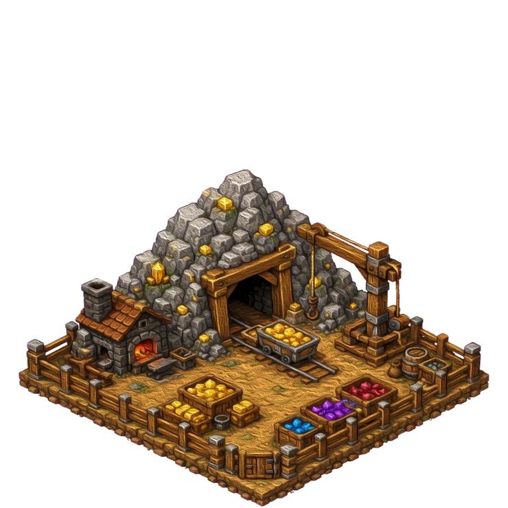

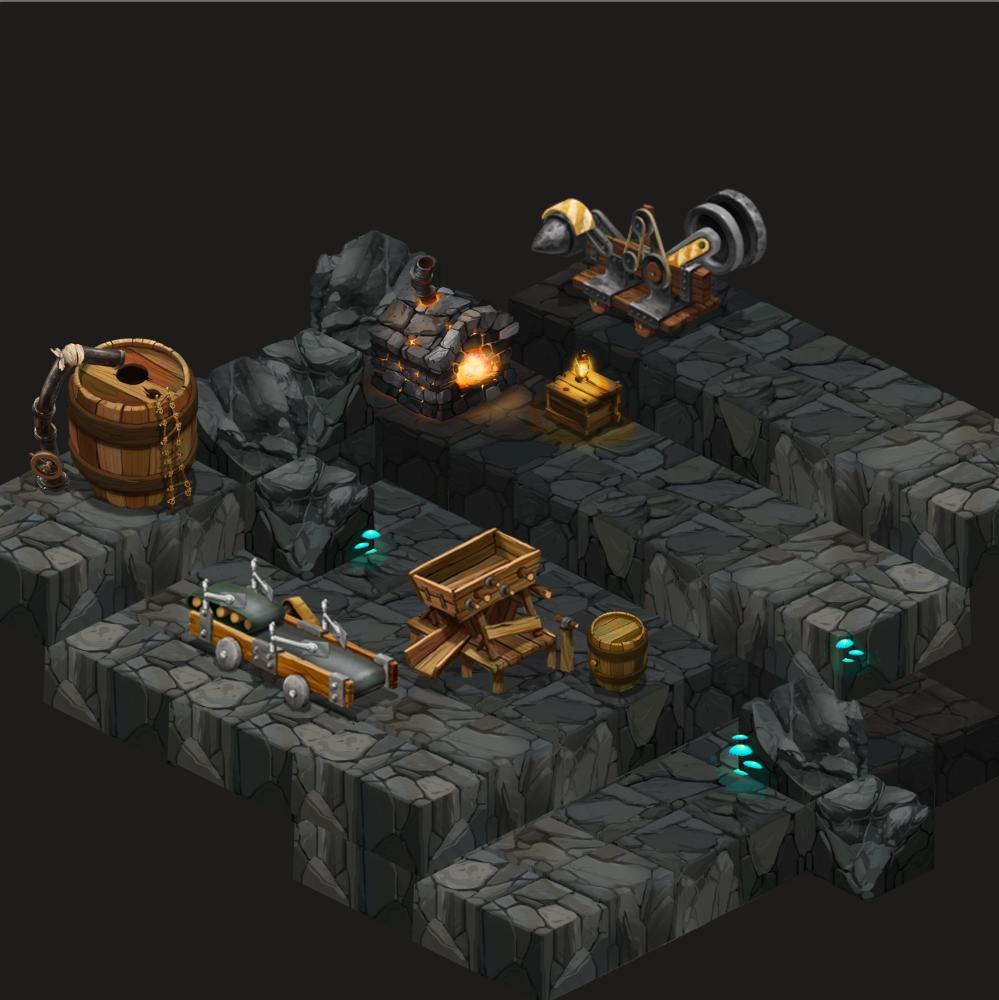

使用等距視角呈現採集區與工坊，視覺上比傳統俯視像素更具有立體感。
項目	評估
開發成本	中
手機效能	優秀
地圖製作	中等
石頭破碎回饋	中高
物品收藏展示	高
美術擴充性	中等

方案 C｜3D Low Poly 等距視角

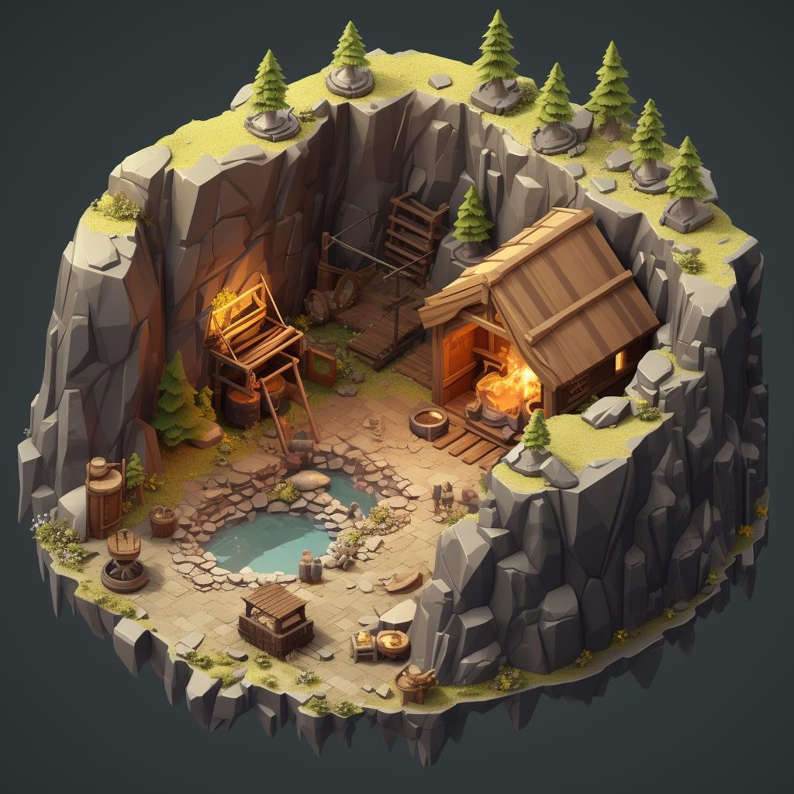
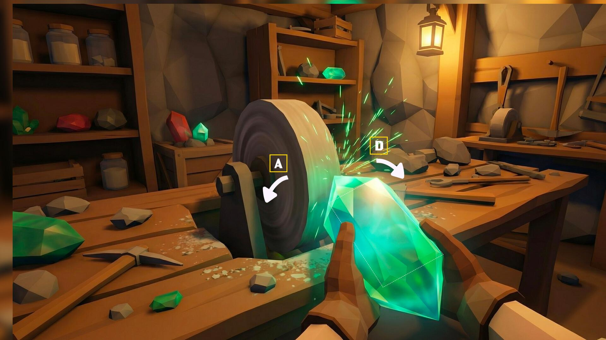

使用固定角度的 Orthographic Camera，角色、石頭、地圖及設備均為 3D 模型。
項目	評估
開發成本	中
手機效能	良好，需優化
地圖製作	中等
石頭破碎回饋	極高
物品收藏展示	極高
美術擴充性	高

最大的優點是同一顆石頭可以旋轉、縮放、重新上色、改變材質，也可以利用物理系統呈現搬運與碎裂。

方案 D｜3D 微縮模型與桌面療癒風格

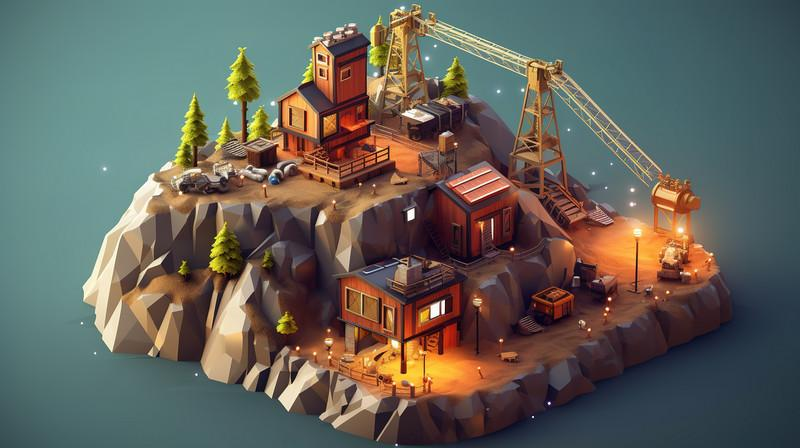

整個世界像是一個放在桌面上的微縮模型，採用柔和光影、低飽和色彩及玩具般的物理回饋。
項目	評估
開發成本	中至高
手機效能	良好，需控制光影
地圖製作	中等
石頭破碎回饋	極高
物品收藏展示	極高
美術辨識度	極高

這個方向比較容易建立獨特的遊戲品牌，也能讓工業設備、修仙法寶及神話物品維持統一的美術語言。

如果採用大量手繪素材，後期設備與神話物品的製作成本可能比較高。

目前最推薦方案 C：3D Low Poly + 固定等距視角，搭配方案 D 的柔和材質與微縮模型感。

不需要開放世界、自由旋轉鏡頭或高精度角色模型。石頭、水晶、工坊設備才是畫面的主角。

但現階段仍然保留 2D 選項，直到破石 Prototype 完成後再做最終決策。
14. Technical Architecture｜Godot 技術架構
不論最終選擇 2D 或 3D，我都建議使用 Data-driven Architecture（資料驅動架構），將遊戲數值、資源管理、經濟系統與實際畫面分離。

這對增量遊戲尤其重要。後期玩家可能每秒處理數百甚至數千顆石頭，不應該真的在場景內生成同等數量的物理物件。
14.1 整體架構

Layer	職責
Presentation	場景、模型、UI、粒子、動畫
Interaction	玩家輸入、移動、互動
Simulation	採集、加工、物流、自動化運算
Game Data	岩石、物品、地圖與設備定義
Game State	金錢、庫存、進度與存檔

例如切換至另一張地圖時，原本工坊的場景可以被卸載，但工坊的生產邏輯仍然持續運作。

項目	建議
Engine	Godot 4.x Stable
Language	GDScript
Rendering	Mobile 或 Compatibility，依目標裝置測試
Game Configuration	Custom Resource .tres
Runtime State	自訂 RefCounted Class
Save Data	JSON + Schema Version
UI	Control Nodes、Theme Resource
Input	InputMap
Event Communication	Signals
Physics	Godot Physics
Multiplayer	不需要
Backend	不需要
Database	不需要

以目前的遊戲規模，不需要引入 ECS、第三方依賴注入框架或複雜的後端服務。
14.3 專案目錄結構
採用 Feature-based Architecture，讓每個功能的 Scene、Script 與相關資源集中管理。

res://
├── autoload/
│   ├── game_state.gd
│   ├── game_database.gd
│   ├── simulation_manager.gd
│   ├── save_manager.gd
│   └── scene_manager.gd
│
├── core/
│   ├── economy/
│   ├── inventory/
│   ├── loot/
│   ├── progression/
│   └── simulation/
│
├── features/
│   ├── player/
│   ├── mining/
│   ├── transportation/
│   ├── workshop/
│   ├── processing/
│   ├── automation/
│   ├── collection/
│   └── upgrades/
│
├── worlds/
│   ├── stone_meadow/
│   ├── crystal_cavern/
│   ├── lost_desert/
│   ├── volcanic_depths/
│   ├── spirit_realm/
│   └── asgard_ruins/
│
├── data/
│   ├── rocks/
│   ├── items/
│   ├── loot_tables/
│   ├── equipment/
│   ├── machines/
│   └── maps/
│
├── ui/
│   ├── hud/
│   ├── inventory/
│   ├── upgrades/
│   ├── collection/
│   ├── world_map/
│   └── components/
│
├── assets/
│   ├── models/
│   ├── sprites/
│   ├── textures/
│   ├── materials/
│   ├── shaders/
│   ├── audio/
│   └── vfx/
│
├── tests/
├── main.tscn
└── project.godot

│   ├── equipment/
│   ├── machines/
│   └── maps/
│
├── ui/
│   ├── hud/
│   ├── inventory/
│   ├── upgrades/
│   ├── collection/
│   ├── world_map/
│   └── components/
│
├── assets/
│   ├── models/
│   ├── sprites/
│   ├── textures/
│   ├── materials/
│   ├── shaders/
│   ├── audio/
│   └── vfx/
│
├── tests/
├── main.tscn
└── project.godot

2D 與 3D 的差異主要集中在 features 內的場景實作，以及 assets 與 worlds。經濟、掉落、庫存及自動化系統都可以共用。
15. Data Model｜遊戲資料結構
15.1 核心資料模型
Model	職責
ItemDefinition	可取得物品的靜態資料
RockDefinition	原石種類與屬性
RockInstance	單顆原石的實際狀態
LootTable	原石的物品產出規則
EquipmentDefinition	玩家裝備定義
MachineDefinition	自動化設備定義
MachineState	設備等級、工作進度
MapDefinition	地圖資源與解鎖條件
MapState	採集進度及資源剩餘量
InventoryState	玩家與倉庫的庫存
CollectionState	收藏紀錄
PlayerState	玩家能力及裝備
SaveData	完整遊戲存檔

靜態 Definition 使用 Resource，Runtime State 則使用獨立的資料物件。避免直接修改共用的 .tres 資源，導致同類型的所有石頭一起改變。
15.2 ItemDefinition

class_name ItemDefinition
extends Resource

enum Rarity {
    COMMON,
    UNCOMMON,
    RARE,
    EPIC,
    LEGENDARY,
    MYTHIC
}

enum Category {
    MINERAL,
    CRYSTAL,
    FOSSIL,
    ARTIFACT,
    SPIRIT_STONE,
    ARTIFACT_FRAGMENT,
    ANOMALY
}

@export var id: StringName
@export var display_name: String
@export_multiline var description: String

@export var rarity: Rarity
@export var category: Category

@export var base_price: int = 1
@export var collection_id: StringName

@export var icon: Texture2D
@export var visual_scene: PackedScene

未來要新增靈石、水晶或神話碎片，只需要新增 Resource，不需要修改核心系統程式碼。
15.3 RockDefinition

class_name RockDefinition
extends Resource

@export var id: StringName
@export var display_name: String

@export var mining_health: float = 10.0
@export var breaking_health: float = 5.0

@export var size: float = 1.0
@export var transport_slots: int = 1

@export var required_tool_tier: int = 1

@export var loot_table: LootTable
@export var material_id: StringName

@export var visual_scene: PackedScene
@export var fractured_scene: PackedScene

15.4 RockInstance
每顆原石可以擁有獨立的狀態。

class_name RockInstance
extends RefCounted

var instance_id: int
var definition_id: StringName

var seed: int
var remaining_health: float
var quality_multiplier: float = 1.0

為什麼需要 Seed？
我建議玩家在取得原石時，就生成該顆原石的 Seed，而不是在敲開的瞬間才完全隨機決定內容。

這樣可以做到：
- 原石外觀與內部物品有關聯。
- 裂縫發光與音效能提供真實線索。
- 重新讀取存檔不會改變石頭內容。
- 不同玩家可以分享特殊原石的 Seed。
- 自動化與手動加工可以共用掉落機制。
若需要跨遊戲版本維持結果一致，則應同時保存掉落表版本，或直接保存已決定但尚未揭露的掉落結果。
16. Rock Lifecycle｜原石生命週期

WORLD_NODE - DROPPED- CARRIED- STORED- PROCESSING- REVEALED
每次狀態轉換都由核心系統管理，而不是由場景中的模型自行決定。

例如石頭被搬入倉庫後，場景中的石頭模型可以消失，但 RockInstance 仍然存在於 Inventory。

這也可以避免下列問題：
問題	解決方式
重複拾取同一顆石頭	狀態轉換時驗證物件歸屬
破石動畫觸發兩次獎勵	核心系統只允許一次揭露
切換地圖後原石消失	Inventory 不依賴 Scene
存檔後重新抽取掉落	保存 Seed 或原始掉落結果
自動化產生重複收入	統一處理庫存轉移與交易

17. Physics & Destruction｜物理與破碎系統
這是選擇 2D 或 3D 時最關鍵的技術差異。
17.1 破碎技術比較

方案 A：預切割模型 Pre-fractured Mesh

預先將石頭製作成數個碎片。破碎時替換模型並加入物理衝量。

開發難度：低至中。最適合 MVP。

方案 B：Voronoi Fracture

使用預先生成或即時運算的 Voronoi 碎片，呈現更自然且多樣化的碎裂。

開發難度：中至高。適合後續優化。

方案 C：Shader 裂痕

透過裂痕遮罩及耐久度控制岩石表面的破壞程度與內部發光。

開發難度：低至中。適合與方案 A 結合。

方案 D：即時 Mesh Slicing

依照玩家切割位置動態生成模型截面。

開發難度：高。初版不建議。

最適合目前專案的組合是 預切割模型 + Shader 裂痕 + 少量真實物理碎片。
17.2 3D 原石場景結構
RockEntity (Node3D)
├── MeshInstance3D
├── StaticBody3D
│   └── CollisionShape3D
├── InteractionArea (Area3D)
│   └── CollisionShape3D
├── CrackEffect
├── HitParticles
├── AudioStreamPlayer3D
└── AnimationPlayer

石頭在最後一擊時替換成破碎場景。

FracturedRock (Node3D)
├── Fragment01 (RigidBody3D)
├── Fragment02 (RigidBody3D)
├── Fragment03 (RigidBody3D)
├── Fragment04 (RigidBody3D)
├── RevealItem (Node3D)
├── BreakParticles
└── CleanupTimer

17.3 破碎實際流程

原石Mesh - 裂痕shader - 碎片物理 -物品展示
這個方式不需要在執行期間重新計算 Mesh 拓撲，也不需要進行昂貴的動態切割。

同一組岩石碎片可以透過旋轉、縮放、材質變化與隨機衝量，創造大量不同的破碎效果。

18. Performance Design｜效能與大規模產線
增量遊戲與一般物理模擬遊戲最大的技術差異在於：遊戲的數值規模必須可以遠大於實際渲染的物件數量。
18.1 邏輯與視覺分離
假設後期工坊每秒處理 1,000 顆石頭：
Simulation Layer1,000
實際處理量／秒
Presentation Layer50
可見代表性石頭

畫面上不需要真的出現 1,000 顆石頭，而是顯示具有代表性的石頭、輸送帶速度及數量回饋。

數值系統永遠是資源數量的唯一真實來源，物理物件只是呈現效果。
18.2 效能策略
系統	實作策略
靜態大量礦石	MultiMeshInstance3D
移動中的輸送帶物件	路徑插值、物件池
近距離破碎	少量 RigidBody3D
遠距離破碎	粒子與簡化動畫
非當前地圖	純數值模擬
自動化加工	集中式 Tick System
大量相同掉落	批次庫存更新
UI 數值更新	限制更新頻率
石頭碎片	定時回收
音效	同時播放數量限制

Godot 的 MultiMesh 可以降低大量相同 Mesh 的繪製成本，但它不會自動解決碰撞與物理運算的負擔，因此仍需將渲染物件與物理物件分開管理。
Godot Engine (4.3) 正體中文 (台灣) 文件+1

18.3 初始效能預算
以下數字是 Prototype 壓力測試的起始目標，不是 Godot 的硬體限制。
項目	手機目標	PC 目標
Frame Rate	30–60 FPS	60 FPS 以上
活躍物理碎片	40	120
可見輸送帶石頭	100	300
可見礦石實例	500	2,000
Simulation Tick	10 Hz	10 Hz
UI 更新頻率	5–10 Hz	5–10 Hz
自動化邏輯設備	100	500

在尚未確定目標手機型號與美術資產規格前，不應將以上數字當作正式效能承諾。
19. Simulation System｜集中式生產模擬
自動化設備不需要每一台都執行自己的 _process()。

建議由 SimulationManager 統一更新。
extends Node

const TICK_INTERVAL: float = 0.1

var accumulator: float = 0.0

func _process(delta: float) -> void:
    accumulator += delta

    while accumulator >= TICK_INTERVAL:
        accumulator -= TICK_INTERVAL
        simulate_tick(TICK_INTERVAL)

func simulate_tick(delta: float) -> void:
    mining_system.tick(delta)
    transport_system.tick(delta)
    processing_system.tick(delta)
    sorting_system.tick(delta)

以上為架構示意，正式版本還需要限制單一 Frame 的補算 Tick 數量，避免 FPS 過低時形成大量補算。
19.1 設備基本屬性
class_name MachineState
extends RefCounted

var definition_id: StringName
var level: int = 1

var processing_progress: float = 0.0
var is_enabled: bool = true

var input_buffer: Dictionary = {}
var output_buffer: Dictionary = {}

狀態	說明
IDLE	沒有工作
RUNNING	正在運作
INPUT_EMPTY	缺少原料
OUTPUT_FULL	輸出區已滿
DISABLED	玩家手動停用

設備不會故障，不需要維修，不消耗需要額外管理的電力。

只需要透過狀態讓玩家知道目前的產線瓶頸。
19.3 離線收益
由於這是輕鬆向增量遊戲，可以支援離線收益，但初版不需要無限制放置。

建議設定：
項目	初始方案
離線累積上限	8 小時
離線設備	已解鎖且啟用的自動化設備
離線採集	不超過剩餘資源
離線販售	依照玩家設定的販售規則
收藏品	正常登錄
神話碎片	正常保留
離線回饋	返回遊戲時顯示摘要

離線收益使用庫存與生產效率進行批次運算，不需要模擬數十萬次物理操作。
20. UI/UX Design｜使用者介面
延續整款遊戲的輕鬆定位，介面應該避免傳統增量遊戲常見的滿畫面按鈕、數字、紅點及提示文字。

玩家主要操作的是世界內的物件，而不是一直點擊選單。

20.3 UI 頁面清單
畫面	主要功能
Main World	採集、移動與搬運
Workshop	加工、卸貨、自動化
Equipment	更換工具
Upgrade	購買設備及能力
Collection	查看已發現物品
World Map	解鎖及切換地圖
Settings	音量、畫質、震動、操作
Offline Report	查看離線產出

介面遵守一頁一個主要動作的原則。採集時不應顯示完整的升級樹；破石時不應顯示大量經濟統計；圖鑑則不需要同時管理所有設備。
21. Onboarding｜前 30 分鐘遊戲體驗
這款遊戲不需要大量對話或文字教學，可以直接透過環境與設備引導玩家。
00:00–01:001

第一顆石頭

拾取地上的石頭、帶回工作台，親手敲開並發現第一顆水晶。

01:00–03:002

第一次升級

販售後續取得的礦物，購買第一把鎬子或破石槌。

03:00–05:003

第一次挖掘

開始開採不能直接拾取的岩石，一次獲得多顆原石。

05:00–10:004

搬運能力突破

解鎖手推車，減少往返工坊的次數。

10:00–15:005

第一次稀有發現

透過早期保底機制，取得具有特殊揭露動畫的物品。

15:00–20:006

第一台自動化設備

解鎖自動敲擊機，玩家可以一邊採集，一邊持續加工。

20:00–30:007

進入第二張地圖

完成初始採集區，解鎖晶洞地圖及新的礦物種類。

初期體驗目標
指標	目標
第一次互動	5 秒內
第一次敲開石頭	30 秒內
第一次獲得金錢	60 秒內
第一次升級	3 分鐘內
第一次操作方式質變	10 分鐘內
第一次自動化	20 分鐘內
第二張地圖	30 分鐘左右

這些是遊戲節奏的測試目標，而不是固定限制。
22. MVP Scope｜最小可行產品
我建議將 MVP 控制在兩張地圖，不要一開始就製作修仙、北歐神話及宇宙世界。

先證明真實礦物的採集、搬運及加工足夠好玩，再擴充世界觀。
Prototype 開發範圍
2
地圖

6
原石種類

24
收藏物品

8
工具

4
自動化設備

30–60
遊玩分鐘

22.1 MVP 必要功能
開發功能 Checklist

0 / 22

核心操作
[ ] 玩家移動與互動
[ ] 拾取散落石頭
[ ] 挖掘岩石
[ ] 背包及手推車
[ ] 倉庫卸貨

加工與經濟
[ ] 手動敲擊原石
[ ] 裂痕與物理碎片
[ ] 物品揭露及掉落表
[ ] 販售與金錢
[ ] 工具升級

自動化
[ ] 自動採集機
[ ] 自動運輸
[ ] 自動破石機
[ ] 自動販售

遊戲進度
[ ] 兩張採集地圖
[ ] 地圖解鎖及重置
[ ] 物品圖鑑
[ ] 存檔與讀檔

體驗與品質
[ ] 音效與粒子
[ ] 基本 HUD
[ ] 操作及畫質設定
[ ] 效能壓力測試

 複製開發清單
22.2 暫時不做的功能
功能	原因
多人連線	非核心體驗
開放世界	地圖製作成本過高
複雜 NPC 系統	不影響主要循環
戰鬥系統	偏離輕鬆定位
生存及飢餓	增加不必要壓力
即時地形破壞	技術成本較高
自由工廠建造	過度複雜化
裝備耐久度	造成重複維修負擔
大量任務系統	可由自然成長取代
Prestige 轉生	先驗證基本成長曲線
帳號與雲端存檔	初版完全離線

23. Development Roadmap｜開發時程
以下以單人開發、已具備 Godot 基礎為前提，規劃一個 12 週的 MVP 開發範圍。實際工期主要取決於美術資產製作及破碎效果的複雜程度。

階段	交付成果
Week 1–2	可操作的破石 Prototype，決定 2D 或 3D
Week 3–4	第一人稱採石、Voronoi 坍落、四種採礦音效、卸貨石堆與室內破石
Week 5–6	天賦樹、品相、拾運機器人及三階自動破石，擴充經濟與存檔
Week 7–8	固定採集機、分類販售、集中模擬與完整產線
Week 9–10	第二張地圖、圖鑑及物品內容
Week 11–12	存檔、效能、音效、美術與平衡測試

24. Development Priority｜第一個 Prototype
即使整份 SPEC 已經規劃到神話世界與自動化工坊，我仍然建議第一個 Prototype 只需要以下五個物件：

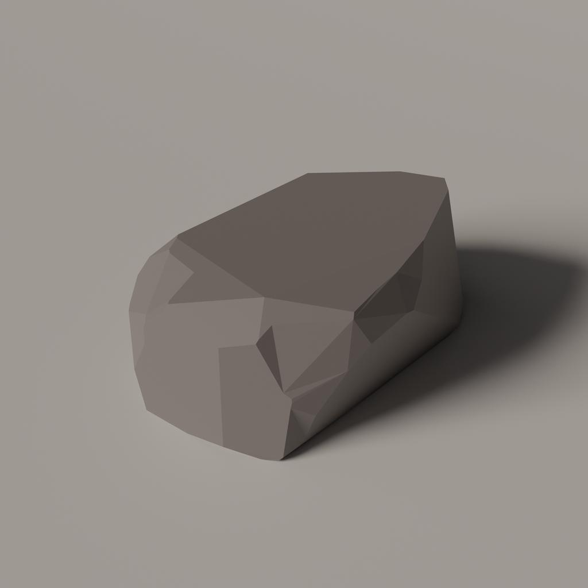普通原石
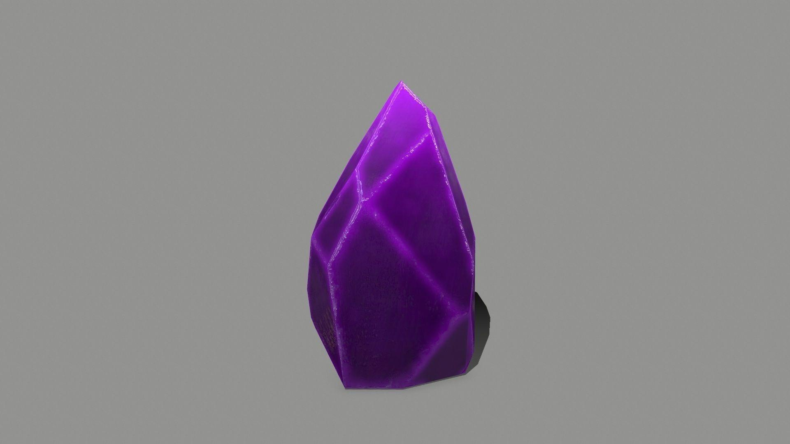內部水晶
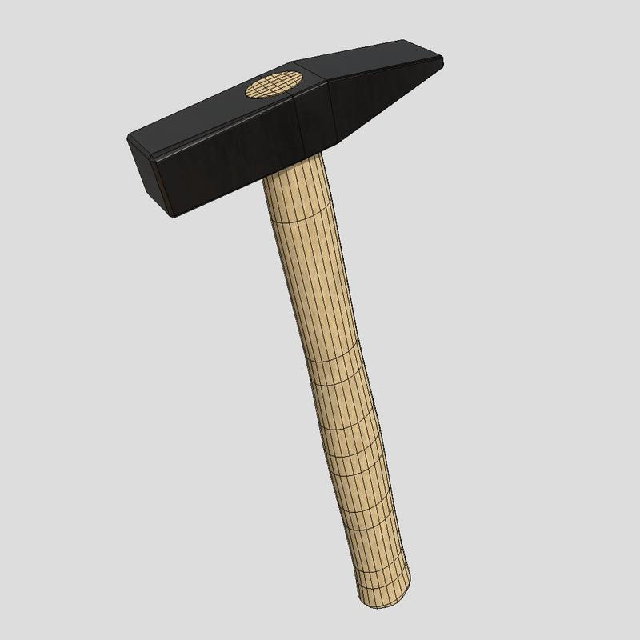手槌 https://plaggy.sellfy.store/p/cc0-hammer-3d/?utm_source=chatgpt.com
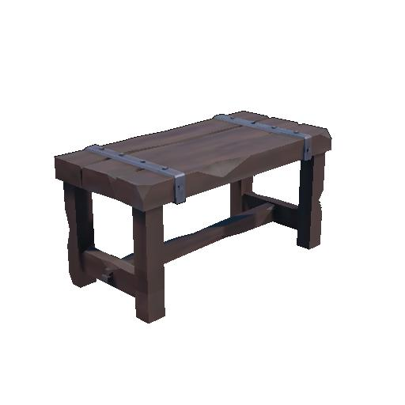工作台
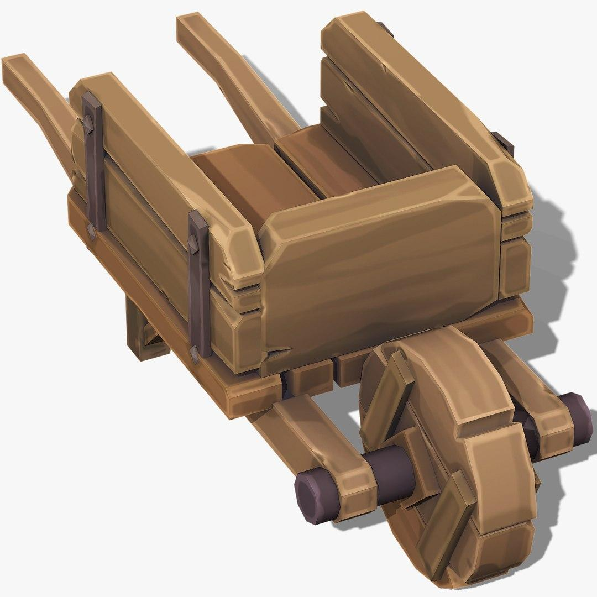手推車

24.1 Prototype V0.1：破石手感測試
暫時不需要角色、不需要移動、不需要地圖。

玩家面前只有一顆石頭，點擊滑鼠即可揮動槌子。

目前樣品台有五擊破石、三階段裂痕、石屑與撞擊聲、品相加成和四種內部結果。敲開後原礦留在台上。再點一下可立即收料，維持長按則在揭曉後約 0.55 秒收料並補上下一顆。首次礦物與成就有提示。

驗收標準：即使沒有金錢與升級，玩家仍然願意連續敲開 20–30 顆石頭。
24.2 Prototype V0.2：搬運測試
已接入碎石平原、第一人稱走跑跳、四種採礦音效、可挖凹岩體與坍落、背包、推車及自動卸貨。普通原石靠近收取，稀有原石手動撿。木屋旁的木製料斗以地面標線引導自動卸貨，內部用剛體堆石，入屋切到有三種原石外形的破石台，敲開後再點擊收走。場景使用 Polyfork 工坊模型、Kenney 日景和可編輯的 Godot 場景。

主要驗證搬運是否本身就具有樂趣，以及玩家是否會因為往返而感到厭煩。
24.3 Prototype V0.3：增量測試
已有破石槌、品相、採掘、出礦、拾取、搬運、體能、自動化八條天賦路線，共 19 個節點。工坊砧台可以開啟 Kenney Adventure 主題的天賦樹，左側選路線，右側可看前置連線，點解鎖才付款。拾運機器人與自動破石串接同一座料斗。自動破石隨升級支援硬度 1 至 3。首次手動收料更新圖鑑與展示架。販售選擇、保底與存檔待實作。

至此就可以驗證整款遊戲的核心循環，而不需要任何正式美術與完整世界觀。

25. 產品方向總結
我認為這款遊戲最有價值的差異化，是它可以讓玩家經歷五種截然不同的成長體驗。

採石者
親手尋找並敲開每一顆石頭

礦物商人
大量搬運、鑑定與販售礦石

工坊經營者
建立完整的自動化流水線

神話考古學家
探索修仙世界與諸神遺跡

跨次元收藏家
從不同世界取得不可能存在的物品

它不應該只是一款採礦模擬器，也不應該只是另一款工廠遊戲。

它真正的核心是：從看似平凡的物體中，發現不平凡的東西。

目前仍有三項重要設計決策尚未定案，分別是 2D／3D 美術形式、玩家是否需要控制實體角色，以及採集與工坊是否使用獨立場景。本規格中的固定設備位置、有限地圖資源、離線收益及 12 週開發時程也都是初版建議，尚未經過實際測試。
章節	內容
01	Game Overview｜遊戲總覽
02	Core Gameplay Loop｜核心循環
03	World Design｜世界與地圖
04	Mining System｜採集挖掘
05	Transportation System｜搬運物流
06	Rock Processing System｜原石加工
07	Loot & Discovery｜掉落與驚喜
08	Economy & Progression｜經濟成長
09	Automation System｜自動化流水線
10	Collection System｜收藏博物館
11	Map Progression｜地圖進度
12	Game Feel｜操作手感
13	Art Direction｜美術與 2D／3D 評估
14	Technical Architecture｜Godot 技術架構
15	Data Model｜資料模型
16	Rock Lifecycle｜原石生命週期
17	Physics & Destruction｜物理與破碎
18	Performance Design｜效能設計
19	Simulation System｜生產模擬
20	UI/UX Design｜介面設計
21	Onboarding｜新手體驗
22	MVP Scope｜最小可行產品
23	Development Roadmap｜開發路線圖
24	Development Priority｜Prototype
25	Product Direction｜產品方向總結