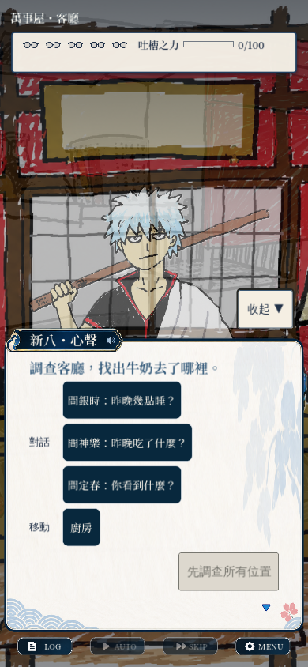

# debt-commission：討債委託／萬事屋吐槽 ADV 評論

## 評論結論

**最值得賣的不是視覺小說引擎或分支數量，而是「玩家真的抓到一句話的破綻，然後親手打出笑點」。** 現有第一章已有這個雛形，閱讀便利功能也相當完整；下一步應優先證明一集從開頭到收尾好讀、好笑、願意重看。

作為玩家，我能理解草莓牛奶失竊的動機，且證據與角色嘴硬能自然產生吐槽。作為評論者，我會追問：這個笑點是我的判斷帶來的，還是找到唯一正確按鈕後播放固定段子？作為開發者，我會優先降低內容編排和介面狀態互相牽動的成本。

## 現況與證據

閱讀了第一章 `.dialogue` 的開場／調查／首回合文本、TsukkomiRound 的判定契約、StoryRunner 的評價規則，以及外殼的存檔、計時與 overlay 邏輯。第一章截圖由目前來源執行產生；測試涵蓋 story、chapter1、save_validation、save_slots、chapter_flow、tutorial。未完整人工逐分支讀完所有章節，未聽音訊做混音評分。

## 優點

| 優點 | 玩家為何在意 | 建議保留 |
|---|---|---|
| 牛奶失竊小事件、嫌疑人嘴硬、證詞矛盾 | 不需長篇世界觀就能進入情境；M12→M13 的自露馬腳有效 | 用具體物件與人物關係帶出系統 |
| 證據、聽補充、吐槽有因果關係 | 有機會產生「我發現了」的滿足感 | 正確反應回扣剛找到的資訊 |
| 消音條、牌子、漫畫 cut-in | 能把互動介面本身變成喜劇的一部分 | 作為少數驚喜，不每回合強制全套 |
| AUTO、紀錄、快速存讀、手動欄位、文字與輔助設定 | 尊重閱讀型玩家的節奏 | 新增內容仍遵守暫停、回讀與存檔規則 |
| 銀魂和紙與深藍按鈕已形成視覺辨識 | 介面不像一般原型拼裝 | 沿用已驗收 PNG 與 scene，不重做框線美術 |
| story source、source tag、校驗器、scene 化與眾多測試 | 可以擴充內容，也能追溯作者文本 | 保留作者可直接編輯的來源與驗證流程 |

## 玩家體驗的缺點與改善

### 1. 喜劇可能被「考試＋失敗扣命」壓過【設計判斷／P2】

證言、證據、限時選詞、連擊、QTE、眼鏡生命、充能、隱藏互動和章末評價同時存在。`story_runner.gd:300` 的評級主要由剩餘眼鏡和 Game Over 次數決定；`tsukkomi_round.gd:34` 起，錯誤出手扣眼鏡、三次後才提示。這會鼓勵保守找標準答案，也可能讓想看好笑失敗台詞的人覺得被懲罰。

**改善**：把「內容探索」與「技巧挑戰」分開評價。保留寬鬆模式，再考慮無限時閱讀模式；第一次試錯提供有用且不同的反應，不必立即要求重做一整回合。評價可呈現「抓到幾種觀察／解鎖幾種吐槽」而非只看完美率。挑戰模式仍能保留 S 評價。

**驗收**：首次玩家失敗後能說出下一次要改哪個判斷；沒有為了避免失敗而停止探索笑點。數值與是否新增模式需依真人回饋決定。

### 2. 調查畫面有「知道要找，卻不知道在哪裡找」的風險【畫面確認＋設計判斷／P2】

390×844 的目前調查畫面中，底部對話／話題卡佔了接近半屏，角色又覆蓋背景；「先調查所有位置」是鎖住的出口，沒有直接顯示還差哪類資訊。已經有收起、拖曳背景和新手教學，不能把它描述成完全沒有引導；真正要驗證的是教學之後玩家是否能自行找出線索。

**改善**：調查模式用較小的常駐指令帶，讓背景成為主體；任務卡顯示如「已找到 2/4」；卡住一段時間才提示一個區域或觀察方向。需區分已找過、可互動、只裝飾的視覺狀態，避免直接把全部答案高亮。

**驗收**：找線索時不用反覆收合才能辨識同一個熱區；玩家能區分移動／對話／調查，且知道何時可繼續。

### 3. 分支規模的野心領先於單集完成度【README 確認＋設計判斷／P2】

README 同時列第一章試讀、各 Phase 技術片段、EP00、圖編輯器與大量分支方向。這些工具對製作有用，但對玩家而言，還不能取代一次完整的故事起伏。第一章某個 BR 結局仍標示待作者試讀。

**改善**：選一個正式試玩入口；先把一個短篇的鋪陳、誤導、反轉、結尾及製作名單做完整。分支優先做「選擇後立即有不同的角色反應，之後適度匯流」，只有主題上真的不同才分裂整條劇情。

**驗收**：能列出每個主要選擇帶來的資訊、關係或結局差別；沒有只是增加文本量的假分支。試玩版不把技術 sample 當正式章節混在同一入口。

### 4. 畫面完成度仍受素材風格與角色表演限制【畫面確認／P2】

和紙 UI 已具細節，但目前背景、人物輪廓與表情精度不完全一致，調查截圖的角色與環境有明顯原型感。好看的邊框無法替代面部演出；吐槽作品尤其依靠停頓、眼神與反應鏡頭。

**改善**：先精修高頻的少數背景與角色表情：中性、懷疑、嘴硬、驚訝、崩潰；每段笑點只安排一個主視覺焦點。把音效／停頓／cut-in 的節奏列成演出表，用同一段測可讀性而非一次補齊全部素材。

### 5. 題材依賴與可銷售內容定位仍需產品決策【資產／文本確認】

目前故事直接使用銀時、新八、神樂等角色與作品場景；外觀包雖已存在，基底仍是 `skins/gintama/skin.json`（`scripts/skin.gd:9`）。

若目標是正式商業產品，需明確選擇有可核對商業使用依據的作品方向，或建立原創角色與背景包。本輪沒有審核完整授權文件，**不在此判斷是否合法，也不因看見現有角色就推定有／沒有授權**。原創包應能從乾淨的 base 完整運行，不能只改標題卻繼承原作人物／音樂。這是後續產品決策，不要求本次替換已核准和紙外觀。

## 程式改善

### D-01／P1：跨章進度的可靠性低於閱讀存檔【程式確認】

位置：`scripts/story_library.gd:226`、`:238`、`:335`。

手動存檔用 AtomicFile、有效性驗證和備份；settings 也用 atomic 寫入。相對地，章節通關、結局、carry 和鑑賞用 `config.save(progress_path)`，忽略錯誤；`unlock()` 先更新記憶體 cache，再寫磁碟。可能出現當次畫面已解鎖、重新啟動又不見的狀態。本輪未模擬磁碟滿，故不聲稱已觀測玩家資料遺失。

**改善**：獨立 ProgressRepository，統一 encode→atomic commit→更新快取；失敗有回傳與 UI 提示；批次記錄一次章末結算，避免分開多次提交。對非預期欄位型別與舊 schema 做驗證／遷移。

**驗收**：注入不可寫、寫入中止、主檔損壞，重開仍能恢復最後良好結果；不得假裝已存檔。

### D-02／P2：main.gd 的責任與狀態交錯【程式確認】

本輪 `main.gd` 4,335 行，`story_runner.gd` 2,796 行；行數只是提醒，不是單獨判定有 bug 的理由。實質問題是外殼同時管理 scene 組裝、overlay 模式、倒數、輸入、歷史、存檔 schema、故事切換、QA 輸出。`_screen_mode`、`_mode_before_overlay` 和 `_effective_boke_ui_mode()` 必須一起保持一致。

**改善順序**：先抽 ProgressRepository／SaveCoordinator，再抽明確的 ScreenState/OverlayStack 與 ReadingController；RoundController 管回合與暫停 token。Scene 保持現有檔案與 `%` 契約，避免一次大重寫。

**驗收**：倒數中開紀錄→開設定→關閉→存讀檔，應回同一語句、同一剩餘時間；所有入口只走同一個轉移函式。現有依賴私有方法的 UI 測試逐步改走可公開測試的使用者動作。

### D-03／P2：內容與系統文案需不同的翻譯／版本鍵【程式確認】

`.dialogue` 已有來源標記與翻譯提取設定，這是優點；但不少系統提示仍在 `main.gd` 內直接寫字串，`StoryRunner` 的存檔與來源版本又高度相關。

**改善**：保留 source_id 作文本追溯；UI 文案使用穩定鍵；建立「修錯字／改語句」與「改節點結構」不同的存檔相容政策。測試長字串及換語言後按鈕擴張，不只檢查中文缺字。

### D-04／P3：讓測試輸出專注在遊戲問題【程式確認】

headless 測試啟動 MCP runtime 後，在 sandbox 下大量印 TCP listen 失敗；編輯器匯入也有已知外掛退出資源訊息。本輪沒把這些當成玩家遊玩中的記憶體洩漏。runtime 腳本有 export feature guard，不能據此宣稱發行版暴露除錯服務。

**改善**：測試模式明確不啟用非必要 editor runtime 工具；負例錯誤與非預期錯誤分流。這能讓真正的存讀檔問題更容易被看見。

## 最值得做的下一個可玩交付

一個完成的短篇：快速理解事件、一次自由調查、兩次逐步升級的吐槽、一個高潮與收尾；初次失敗能笑、重試有新理解。用目標玩家的停頓／誤解／重試行為決定後續修改，再擴充多章節分支。
