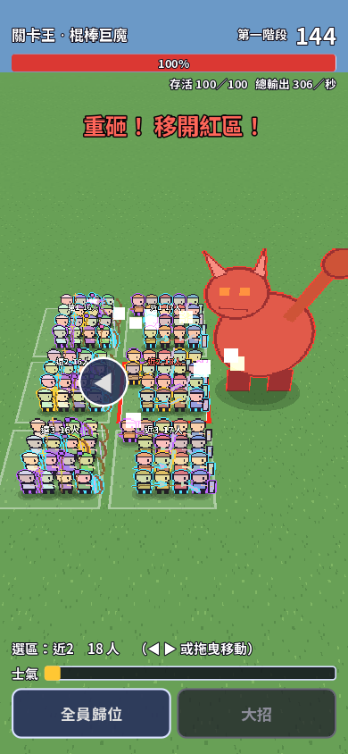

# hero-horde-idle：百人調度很有辨識度，養成理由尚未接上

## 評估結論與範圍

**值得保留的是「一指調度一群人躲過重擊」的規模感；目前比較像驗證戰鬥手感的原型，還不是可持續遊玩的放置養成遊戲。** 百人不是百個有意義的選擇。商業版本要讓玩家從混亂中看懂自己救了誰、哪個隊伍配置有效，以及下一次能改什麼。

本輪讀取 README、`main.gd`、`domain/push_sim.gd`、HUD 與場景、測試及截圖工具；執行 balance、main 測試，另做時間步進與復活統計 probe。截圖為工具設置的代表性狀態，不等於完整真人通關。以下路徑以 `prototypes/hero-horde-idle/` 為根。



## 值得保留的優點

- **核心指令容易說明。** 六區調度把百人戰鬥壓成少量空間決策，有機會兼顧手機操作和團戰感。
- **職業分工有實際作用。** 坦克、近戰、遠程與支援的差別進入模擬，不只是角色立繪。這是後續隊伍養成的基礎。
- **失敗之後提供資訊。** 戰報記錄輸出、治療、保護、復活與倒地診斷，比只給「戰敗」更能支撐重試。
- **模擬與呈現已分開。** `PushSim` 可 headless 執行，既有不同操作策略與種子的平衡測試，讓設計調整有比較依據。
- **產品方向相對克制。** README 的免費展示／一次付費、原創奇幻方向可以成立，無須為了「idle」強加抽卡或每日作業。

## 玩家與評論者視角：缺點及改善

### 1. 看見一百人，卻不容易在意其中一人

目前畫面中的英雄小且密集，外框、箭頭、預警同時爭奪注意力。重擊文字能讀到，但玩家未必能快速辨識選中的是誰、哪群人即將死亡。畫面上方空間和下方人群密度也不均衡。這是本次代表畫面的判斷，尚未經實機觸控測試。

**改善：** 讓平常操作以小隊為單位；選中時突出隊長、職業符號、存活數與移動目標，其餘角色降低對比。保留百人作為規模感，不要求玩家點中單一小人。預警需要同時表達範圍、倒數與嚴重程度，避免只靠紅色。英雄美術升級前先驗證輪廓和選取回饋。

**驗收：** 不教學提示下，玩家能指出目前選中的隊伍、下一次攻擊落點，並完成一次正確調度；在目標手機上不需精準點中小圖示。

### 2. 戰報告訴我輸了，卻還沒有完整的改善途徑

現有版本以固定百人與戰鬥假說為主，README 的後續成長尚未形成產品循環。沒有保存／養成在此階段是範圍選擇，不是「漏寫存檔」的 bug；但若以放置養成遊戲販售，這會是承諾缺口。

**改善：** 先做一個有限閉環：一個 Boss、少量明確隊伍配置、一種可保存的成長選擇。戰報指出具體情境，例如「第二次重砸時近戰留在危險區」，並讓玩家在下一場調整隊伍或站位。不先增加數十種貨幣與成長軸。

```text
配置小隊 → 打王／調度 → 戰報定位失敗 → 改配置或升級 → 再挑戰
    ↑                                                   │
    └────────────────── 可保存的成長 ────────────────────┘
```

**驗收：** 玩家能說出下一場要改什麼，改動後從戰報看見效果；一次失敗不用長時間重複沒有選擇的開場。

### 3. 「放置」和高懲罰閃避需要明確的產品承諾

若玩家認為可以掛機，卻必須頻繁拖隊躲致命攻擊，標題和實際體驗可能衝突。反過來，若操作提升不明顯，又會讓調度失去意義。既有 idle／good／human／late 策略測試能比較規則，不能代表真人理解和操作能力。

**改善：** 明確選擇低壓自動推進、主動操作加速，或需要注意力的短局戰鬥。用同等養成比較放置與操作的收益、失敗頻率、所需注意力，先向玩家展示產品實際承諾。主動技能和首領節奏應製造決策間隔，而非持續催促點擊。

### 4. MVP 不應成為誤導玩家的單一真理

輸出、治療、減傷和復活可以展示，但加總分數帶有設計權重，不能自然代表「最重要英雄」。目前光環等價值也不全納入歸因；這部分有明示設計，不應當作漏算 bug。

**改善：** 分開給輸出、救援、承傷或關鍵操作表現，並揭露統計口徑。先修 H-01，再讓戰報說明「做了什麼」，避免鼓勵玩家只堆容易刷分的數值。

## 程式碼改善

### H-01｜P2｜復活貢獻使用補師的最大生命，而非目標生命【重現確認】

位置：`domain/push_sim.gd:628`、`:682`。

`_revive()` 恢復目標 `max_hp[j] * REVIVE_HP`；`contribution(i)` 卻用 `saves[i] * max_hp[i] * REVIVE_HP`。補師生命 165、目標 300、復活比例 0.4 時，實際恢復 120，但統計只有 66。被救者生命不同時，單純復活次數也無法還原總恢復量。

**改善：** 在復活成功當下累加實際恢復 HP，分開保存救援次數與數值。回歸案例包含不同生命的多個目標、復活失敗及連續救援，確認戰報與模擬事件一致。

### H-02｜P2｜可變 delta 與單次 timer 判斷讓卡頓改變模擬【重現確認】

位置：`main.gd:69`、`domain/push_sim.gd:279`、`:395`。

主迴圈把 `_process(delta)` 直接送進模擬；部分攻擊／治療計時到期只執行一次，跨過多個時間間隔不會逐步處理。相同種子與放置策略，1/60 秒步進約 87.42 秒全滅，Boss 剩 32749.51 HP；0.5 秒步進約 75 秒全滅，剩 33618.73 HP。2 秒步進也不同。正常 15／30／60 Hz 結果較接近，**這不證明一般 30 FPS 無法遊玩**；證明的是大卡頓沒有明確時間政策。

**改善：** 用固定模擬步長與 accumulator；明確定義過長間隔的補算上限、暫停及回到前景行為。以模擬 tick 記錄操作，建立同種子同指令重播，再測正常幀率與卡頓。若加入離線收益，另建可驗證的收益規則，不用單次巨大 delta 推王。

### H-03｜P2｜戰報、養成與可辨識英雄尚未形成完整閉環【實作／README 確認】

這是功能成熟度，不是單一錯誤行。先定義一個可保存的隊伍／成長資料模型，以及戰報如何映射到下一次決策，再擴英雄數與 UI。存檔應採用 kit 的儲存能力並補自己的 schema／恢復政策，而非直接把整個模擬物件序列化。

### H-04｜P2｜近戰人數上限受固定遍歷順序影響【程式確認、設計風險】

位置：`domain/push_sim.gd` 的 `_fight()`，約第 445 行後。

近戰容量在遍歷角色時分配；固定名冊順序可能成為隱性的出手機會優先權。這不一定違反設計，但玩家很難從畫面得知。先決定容量應依距離、站位、職業或輪替分配，再讓規則可見，並以調換名冊順序的測試確認是否符合設計。

### H-05｜P2｜手機中斷與暫停行為應在加內容前定義【抽讀範圍內待補】

本輪 main／HUD／scene 未找到完整的暫停、設定與失焦處理流程。手機切換 App、長時間停留背景、結果畫面重開都需要明確政策；這與 H-02 的時鐘模型一起處理。音效回饋亦需實際聆聽驗收，本輪使用 dummy audio，不能評論混音完成度。

## 建議下一個可交付切片

以「一個 Boss、可辨識的小隊、一次養成選擇、可保存進度、可信戰報」為目標。先讓一次重試有理由，再擴 Boss 與英雄數量。成功不是打贏次數增加，而是玩家知道自己為什麼贏、為什麼輸，並願意自主再試。
