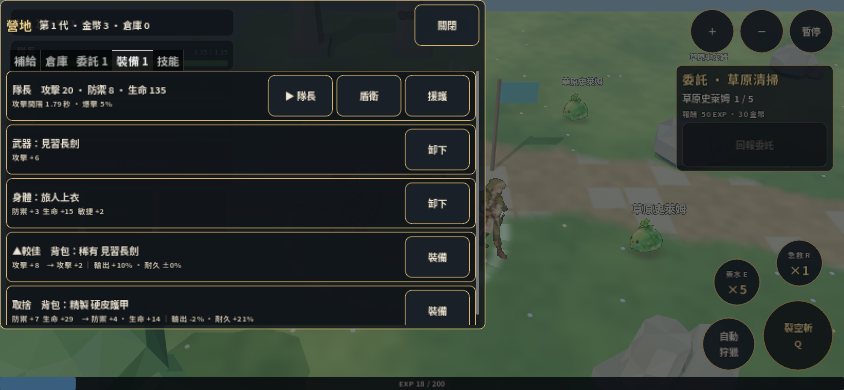

# skybound-blades：浮空劍域評論

## 評論結論

**最有潛力的是「知道自己帶了什麼出去，也知道該帶多少收穫回來」的遠征張力。** 三名隊員的分工、補給、倉庫、撤退、死亡傳承，已構成有意義的風險架構。商業品質的關鍵是讓玩家把死亡歸因於可理解的決策，而不是 AI 行為、看不清的 UI 或存檔失常。

單層是合理的切片範圍，不能因為還沒有百層就否定它。現階段應先把一層做好；目前有幾個可重現的功能缺陷，比新增第二層更值得先修。

## 優點

| 優點 | 商業體驗價值 |
|---|---|
| 純 domain 與呈現層分離、50 ms 固定步進 | 可以獨立調整平衡、重現戰鬥，而不必靠完整 UI 操作 |
| Run／Profile 分離，配發品不能賣／存倉 | 風險與永久成長邊界清楚，也阻止簡單的開局套利 |
| 擊殺 receipt、備份、死亡 tombstone | 已經想到重複結算和讀舊檔復活的問題 |
| 隊長、盾衛、援護有各自工作 | 三人同行不只是裝飾，能產生隊伍感 |
| 裝備比較分輸出與耐久，顯示取捨 | 比單一戰力數字更支持風險決策 |
| 技能連招有前置標記、熟練度與成本 | 有形成 build 的可能，並非只把所有大招同時開 |
| 手機直向會暫停提示轉向，拒絕動作有說明 | 已有照顧玩家輸入情境的意識 |

## 玩法缺點與改善

### 自動狩獵與永久死亡之間需要明確的「責任契約」【設計判斷／P1 產品決策】

玩家可能把自動狩獵理解為可以放心離開，但本作保有高風險、有限補給、2 秒撤退與永久死亡。即使數值公平，只要預期不一致，損失就會被理解成遊戲坑玩家。

**改善**：在第一次出營用實際情境教會安全線：剩餘補給、撤退所需時間、預估可承受危險；Boss 區有明確進場確認或行為邊界。自動模式顯示它「會做的事」與目前停止／撤退理由。可提供自動返營條件，但別讓 AI 保證所有情境無風險。

**驗收**：失敗前玩家能說出可能失去的資產；失敗後看得懂死亡原因與下次可改善的選擇。不是單靠勝率落在某個區間。

### 自動戰鬥可能讓「好裝備」比操作和組合更有感【設計判斷／P2】

現有同行閃避與自動施技能讓隊伍看起來很能幹，但也容易讓玩家只等待等級提高。舊量測中「無人閃避全滅、隊友閃避全勝」證明規則有效，不等於玩家已覺得有控制感。

**改善**：保留自動普攻，讓少數決策改變風險：選狩獵區、集火目標、何時回營、用耐久換效率、選較安全或較脆的連招。先做兩條能感知差異的 build，不急著添加十幾個同質技能。

### 有限且不可退的連攜印會壓制試組合【設計判斷／P2】

`Skills.unlink_last()` 不退印是已定設計，不是程式 bug。但在內容少、玩家還不知道連招表現時，永久消耗會讓最有趣的試驗變得保守。

**改善**：首次提供免費試編／試打或營地訓練；正式提交前展示消耗、效果和解除規則。是否允許有限重置，由體驗測試決定。不能用「增加更多印」掩蓋玩家根本不敢試的原因。

### 手機文字不等於按鈕碰得到【畫面及配置確認／P2】

`project.godot` 設計尺寸 1440×900；844×390 橫向下約按高度縮成 0.433 倍。`ui/theme.tres` 的預設 22、SmallLabel 18 約成為 9.5／7.8 輸出像素。營地卡只佔左側部分畫面，裝備比較行尤其細。截圖能看出金框與卡片，卻很難舒服讀數值。

**改善**：手機營地採接近全屏的面板，將三人切換、裝備行和比較內容重新排版；主要數值與說明用手機可讀尺度，長比較可展開。不只同比放大整個桌面 HUD。

**驗收**：目標手機上不用 pinch zoom 就能讀懂一件裝備的兩軸差異並完成操作；需在瀏海、瀏覽器工具列和長文字條件下實測。

## 程式缺陷

### S-01／P1：改第二技能格會抹掉已建立連招【重現確認】

位置：`domain/skills.gd:124`，尤其 `:129` 與 `:136`。

重現：Lv10，已學 cleave/rising/whirl，第一格 cleave，已有 `[cleave,rising]` 連招。呼叫 `equip(tuning, run, "leader", "whirl", 1)` 成功，但連招變成 `[cleave]`。第一格沒換，之前花的連攜印卻失去效果。

原因：不論改哪一格，結尾都用第一格重新建一元素 chain；另有 `slots.erase(id)` 把陣列壓縮，重新裝回／移動同一技能可能改變其他格。

**改善**：以格位取代陣列 erase；只有起手技能真的改變時處理 chain，非起手格不碰 chain。明確區分交換、移動與替換。

**驗收**：第二／第三格任意換裝不改既有連招或印；同一格重裝是 no-op；跨格移動不意外刪掉原本其他技能。

### S-02／P1：任務冷卻跨存讀檔使用不同時鐘【重現確認】

位置：`domain/run.gd:276`、`:328`、`:348`；`domain/battle.gd:19`。

`claim()` 寫 `available_at_ms = now_ms + cooldown`，Run 原樣保存該值，但 Battle 重建 `now_ms=0`。本輪在遊玩第 600,000 ms 回報獵殺委託，原設定冷卻 300,000 ms，讀回後等待變成 900,000 ms。玩越久才存檔，偏差越大。

**改善**：決定冷卻是否跨離線流逝。若只計遊玩時間，存剩餘時間或存戰鬥累積時鐘；若計現實時間，使用明確的到期時間與時鐘回撥策略。不能混用兩者。

**驗收**：開局、10 分鐘、1 小時後存讀，餘時都符合相同規則；連續讀檔不增加餘時。

### S-03／P1：可解析 JSON 不代表有效存檔【重現確認＋程式確認】

位置：`domain/save_service.gd:23`、`:35`；`domain/run.gd:335`。

兩個重現：

- 主檔 schema=999，`.bak` 是可讀 schema=1：`load_state()` 回 `{}`，沒有嘗試良好備份。
- 主檔 `{schema:1,run:{}}`：`load_state()` 原樣接受，後續 Run.from_dict 直接讀 id／generation／level 等必備欄位，缺少 schema 層的拒絕。

另由程式確認，`save()` 把任何非空 Dictionary 主檔當可備份檔，可能將語意壞檔複製到 `.bak`。`field.load_game()` 隨後會寫檔，所以不能把所有讀取失敗都等同新玩家。

**改善**：候選逐一做完整驗證，回傳「不存在／可恢復／較新版本／損壞」；只有已知有效主檔可成備份。對較新 schema 不可靜默覆寫；是否採舊備份需明示資料可能回退並保留原檔。

**驗收**：涵蓋未知 schema、合法 JSON 缺欄位、錯型別、未知物品 ID、有效 `.old`／`.bak`、無任何良檔。UI 能區分新遊戲和恢復失敗。

### S-04／P1：未處理持久化失敗，死亡交易也會繼續【程式確認】

位置：`game/field.gd:107`、`:709`。

`save_game()` 丟掉 `save_service.save()` 的 Error，照樣重設自動存檔計時。`_record_death()` 不檢查 `mark_dead()`，繼續改 Profile／寫主檔。不是已做過斷電重現；這是可明確定位的錯誤回傳缺口。

**改善**：回傳具體儲存結果，成功後才更新「已保存」狀態；死亡提交需有可重試、可恢復的次序與冪等紀錄，避免墓碑成功而世代／紀念碑落後。寫不進時告知玩家，保留可匯出的資料與最後良檔。

**驗收**：針對 backup、tombstone、main 各步注入失敗，重新啟動後進度／世代一致，不能默默宣告完成。

## 其他程式改善

- **P2，長期資料成長**：`Run.receipts` 每次擊殺追加並存整份；暫無上限／壓縮。連續玩越久存檔與去重資料越大。先量測一小時／一天的檔案大小與寫入耗時，再依單一有序來源採高水位或有界窗口；不要為了優化丟掉防重複結算保證。
- **P2，狀態／通知契約**：`field.gd` 731 行、`battle.gd` 1,171 行。domain 分層是好的，下一步以存檔協調、技能解算、獎勵結算、HUD adapter 拆責任，別依行數機械分檔。
- **P2，測試補真正有風險的情境**：現有 save round-trip、腐敗 JSON、墓碑、receipt 都有測試；新增跨時鐘、非頭技能格、寫入失敗，比增加更多重複 happy path 更有用。
- **P3，內容 schema**：tuning loader 的部分前提由 assert 保護；內容製作應有明確驗證報告與引用檢查，不把不完整資料留到遊戲初始化才報錯。

## 下一個交付建議

先修 S-01～04 與手機營地閱讀，再做同一層的兩種可辨識隊伍／連招策略，以及一次可理解的高風險撤退。真人能解釋「為什麼這次回營」與「下次怎麼打」後，再投入多層內容與 Boss 正式美術。
