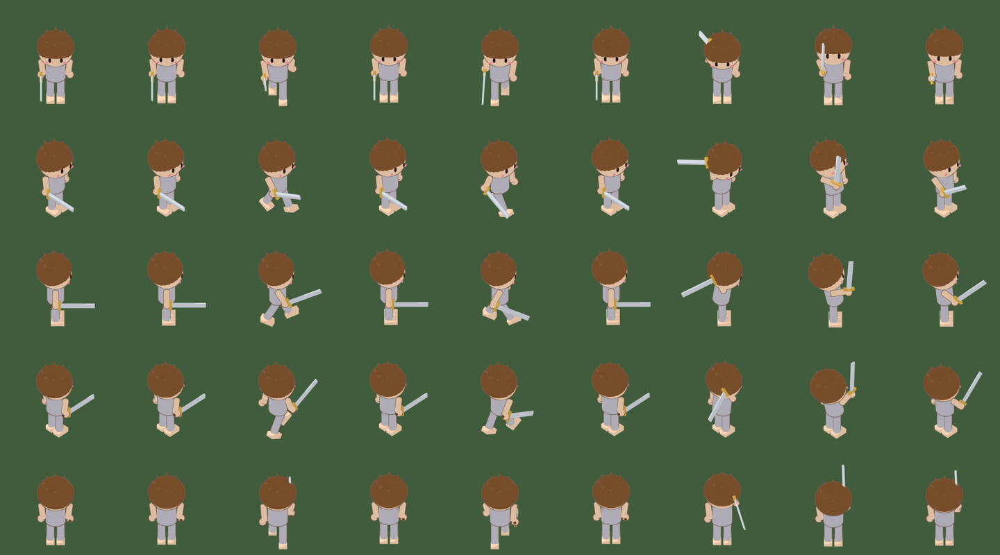

# 3D 建模 → 2D 紙娃娃 sprite 製作流程

2026-10-26 定案，並用測試小人跑通了「Blender 渲染 → 打包 → 進 Godot 試玩」這一段（步驟 7～9）：蓬蓬草原的玩家現在就是這個三層紙娃娃。步驟 1～6 還沒有用真的角色跑過。

## 為什麼走這條路

玩家角色要做紙娃娃（換頭髮、衣服、武器），而且要 8 方向。直接用 AI 生 2D 圖的話，每一層都要跟素體對齊，每新增一件裝備就要重生 55 張，實際上做不下去。

改成 3D：
- 所有圖層由同一副骨架、同一台鏡頭算出來，**天生對齊**。
- 8 方向只是轉角色再渲染一次。
- 改一次動作，所有裝備重新渲染就一起更新。

代價是前期要把建模、綁骨架、渲染這條流程搭好。這份文件記錄每一步要做什麼。

## 全流程

```
 1 概念圖          AI 2D（人選圖）
   ↓
 2 三視圖          AI 2D：正、側、背，A 字站姿，正交（人選圖）
   ↓
 3 建模            AI 轉 3D 或手動建模；素體與每件裝備分開
   ↓
 4 Blender 整理    減面、UV、上色、比例與原點、分 collection
   ↓                （Blender MCP 互動操作，或 agent 寫腳本）
   ★ 檢查點 A      跑 render_sprites.py --preview，進遊戲看畫風
   ↓
 5 骨架            自動綁骨架＋檢查權重；裝備綁同一副骨架
   ↓
 6 動作            idle / walk / attack / hurt / down（Blender 手動做）
   ↓
 7 渲染            render_sprites.py：圖層 × 動作 × 方向 × 幀  ← 已驗證
   ↓
 8 打包            pack_layers.py：每層一張 atlas＋疊圖預覽     ← 已驗證
   ↓
   ★ 檢查點 B      看 preview.png：對齊、方向、動作
   ↓
 9 Godot           import_sheets.gd → 紙娃娃 actor 多層同步播放  ← 已驗證
```

## 分工

| 步驟 | 人（你） | Agent（Claude） | 工具 |
|---|---|---|---|
| 1 概念圖 | 選圖、定案 | 寫 prompt（[art-prompts](../art-prompts/README.md)） | opt image／Scenario |
| 2 三視圖 | 選圖 | 寫 prompt | 同上 |
| 3 建模 | 選 AI 模型結果，或手動建模 | — | AI 轉 3D 服務、Blender |
| 4 整理 | 看結果 | 減面、統一比例、命名、分 collection、上卡通材質 | Blender MCP（互動）／`blender -b -P`（批次） |
| 5 骨架 | 檢查扭曲 | 綁骨架、把裝備掛上骨頭 | 自動綁骨架工具＋Blender |
| 6 動作 | 做動作、決定手感 | 補關鍵幀、統一幀數 | Blender |
| 7～8 | 看預覽圖 | 全自動 | 本資料夾的腳本 |
| 9 | 進遊戲看 | 寫 actor | Godot |

Blender MCP 適合步驟 4～6：一邊看畫面一邊調整。能重跑的批次工作（步驟 7、8，以及之後的整理腳本）一律寫成 `tools/blender/` 下的腳本，用 `blender -b` 執行，結果才能重現。

---

## 步驟細節

### 1. 概念圖

- 產出：Q 版角色全身正面一張，用來定造型與配色。
- prompt：[01-body-master.txt](../art-prompts/01-body-master.txt)（素體），裝備的外觀描述見 10～14。
- 驗收：2～2.5 頭身，縮小到 120 px 仍看得清輪廓，沒有參考任何現有遊戲。

### 2. 三視圖（建模用）

- 產出：正面、側面（朝右）、背面三張，**同高、同腳底線、正交無透視**。
- 姿勢：A 字站姿（手臂往下斜約 45 度、雙腳微開、手指張開），方便綁骨架。
- 素體和每件裝備各畫一組三視圖：裝備要「穿在素體上」的位置畫，背景透明。
- prompt：[04-modeling-threeview.txt](../art-prompts/04-modeling-threeview.txt)。
- 為什麼要三視圖：AI 轉 3D 用多視角輸入，背面和側面會準很多；手動建模時，這三張直接當 Blender 的參考底圖。

### 3. 建模

兩條路，**每個角色選一條**：

| | AI 轉 3D | 手動建模 |
|---|---|---|
| 輸入 | 三視圖 | 三視圖當參考底圖 |
| 優點 | 幾分鐘出粗模 | 拓撲乾淨、面數可控、Q 版比例準 |
| 缺點 | 面數亂、貼圖糊、大頭常歪；整隻黏成一塊 | 要時間 |
| 適合 | 造型複雜的裝備（盔甲、頭飾） | 素體、頭髮、簡單武器 |

**紙娃娃的硬性要求：每件東西要是獨立的模型。** AI 轉 3D 常把頭髮、衣服、武器做成一整塊：
- 素體（光頭、只穿內衣）單獨做。
- 每件裝備單獨做，再套到素體上對位。
- 如果拿到的是整套黏在一起的模型，要在 Blender 裡切開，並把衣服底下缺的素體補回來。

面數參考：素體 3,000～6,000 三角面；一件裝備 500～2,000。最後是渲染成 384 px 的圖，太細的細節看不到。

### 4. Blender 整理（.blend 規範）

渲染腳本只認這份規範。**任何一個角色的 .blend 都要符合**：

| 項目 | 規定 |
|---|---|
| 單位 | 1 Blender unit＝1 公尺 |
| 朝向 | 角色面向 −Y；腳底在 Z＝0；站在原點 |
| 根物件 | 一個 armature 物件（設定檔的 `root`，預設 `Rig`），所有網格都是它的子物件（綁骨架或掛在骨頭上） |
| 身高 | 素體約 1.5 m（Q 版，頭頂到腳底） |
| 圖層 | 每一層一個 collection：`body`、`hair_<款式>`、`outfit_<款式>`、`headgear_<款式>`、`weapon_<款式>`、`offhand_<款式>` |
| 材質 | 卡通材質：Diffuse → Shader to RGB → ColorRamp（CONSTANT，兩階）→ Emission。範例見 `make_test_chibi.py` 的 `toon()` |
| 不要描邊的小零件 | 物件加自訂屬性 `no_outline = 1`（眼睛、腮紅這類貼在表面的小件） |
| 動作 | 每個動作一個 action，名稱＝動作名，開 fake user，從第 1 幀開始 |
| 燈光 | 不用放，渲染時腳本會加一盞固定在鏡頭空間的太陽光 |

**★ 檢查點 A**：整理好、還沒做動作之前，先放一個只有一幀的 `idle` action，跑一次 `--preview`，把圖接進遊戲看畫風。畫風不對就在這裡調材質、描邊粗細、陰影色；做完動作才發現就要全部重來。

### 5. 骨架

- 所有圖層用**同一副骨架**。
  - 衣服：蒙皮綁到素體的骨架（可以從素體轉移權重）。
  - 武器、盾、硬質頭飾：直接掛在骨頭上（parent to bone），不用蒙皮。
- 自動綁骨架工具的選擇：
  - Mixamo 這類工具預設一般人比例，Q 版頭大腿短常綁錯，**先拿素體試一次**。
  - 不行就用 Blender Rigify（半自動，可調骨頭位置），或其他支援自訂比例的自動綁骨架工具。
- 驗收：擺出走路、舉手過頭、蹲低三個姿勢，看肩膀、手肘、膝蓋有沒有扭曲或破面；頭髮與帽子要跟著頭的骨頭動。

### 6. 動作

| 動作 | 渲染幀數 | 每幀停留（1/60 秒） | 迴圈 |
|---|---|---|---|
| idle | 2 | 30, 30 | 是 |
| walk | 4 | 9, 9, 9, 9 | 是 |
| attack | 3 | 8, 6, 14 | 否 |
| hurt | 1 | 18 | 否 |
| down | 1 | 60 | 否 |

- Blender 裡用流暢的動畫做，渲染時只挑關鍵幀（設定檔的 `frames`）。例如 walk 做 24 幀一個循環，取第 1、7、13、19 幀。
- 現成動作庫（Mixamo 等）套到 Q 版身上，常會手穿進頭、步伐太大。Q 版動作很簡單，建議手動做這 5 個。
- 動作要誇張一點：渲染成小圖後，幅度小的動作看不出來。

### 7. 渲染（已驗證）

```bash
"/c/Program Files/Blender Foundation/Blender 5.1/blender.exe" -b art_src/blender/<角色>.blend \
  -P tools/blender/render_sprites.py -- art_src/blender/<角色>.render.json [--preview]
```

- `--preview`：每個圖層、每個方向只渲第一個動作的第一幀，用來快速看畫風。
- 輸出：`art_src/render/<角色>/<圖層>/<動作>/<方向>_<幀>.png`，加上 `render_index.json`。
- 速度：測試小人 3 層 × 9 幀 × 5 方向＝135 張，約 26 秒（EEVEE）。

腳本做的事：
- 正交鏡頭俯角 40 度，跟遊戲鏡頭一致。
- 太陽光固定在畫面左上，轉角色時光不跟著轉，跟 2D 手繪「光永遠從左上來」的習慣一樣。
- 渲染時用反轉外殼法加描邊（不改存檔）。
- 每個方向轉根物件，逐層、逐動作、逐幀輸出。

**紙娃娃的遮擋（holdout）原理**：渲染某一層時，`holdout` 列出的圖層會變成「隱形的遮罩」。它不會被畫出來，但擋在前面的地方會把這一層挖空。例如背面時劍在身體後方，劍的圖就只剩露出來的部分。因此遊戲裡疊圖的順序可以固定（身體在最下面），不用依方向切換。

限制：裝備和裝備之間（例如盾和劍）不互相遮擋，遊戲裡用固定順序疊。如果某一套很在意，可以把對方也加進 `holdout`，但那一層就只能跟那件裝備搭配。

設定檔欄位：

| 欄位 | 說明 | 測試值 |
|---|---|---|
| `cell_px` | 每格大小 | 384 |
| `meters_per_px` | 全遊戲統一的比例尺；格子大小 × 比例尺＝格子在世界中的邊長 | 0.0056（384 × 0.0056 ≈ 2.15 m） |
| `pitch_deg` | 鏡頭俯角，跟遊戲 `CameraRig.pitch_deg` 對應 | 40 |
| `foot_px` | 格子底部保留的透明條（kit shader 會切掉） | 8 |
| `ground_margin_px` | 地面原點以下保留的空間：從斜上方看，腳尖會落在原點下方 | 36 |
| `directions` | 8：畫 5 向再鏡像；4：畫 3 向再鏡像 | 8 |
| `outline_m`／`outline_color` | 描邊粗細（公尺）與顏色（線性 RGB） | 0.012／深褐 |
| `layers` | 圖層 → collection 與 holdout | body、hair、weapon |
| `anims` | 動作 → action 名稱、取哪幾幀、停留、是否迴圈 | idle、walk、attack |

### 8. 打包（已驗證）

```bash
uv run --with pillow tools/blender/pack_layers.py art_src/render/<角色>/render_index.json --out assets/sprites/<角色>
```

- 每個圖層各打成一張 atlas：`<out>/<圖層>/atlas.png` 與 `sheets.json`（godot-kit `sprite_atlas.py` 的格式）。整個角色塞一張會超過手機上限 4096 px。
- 每層的比例固定 1:1，腳底線全部一致，所以疊起來跟 Blender 裡一樣。
- `<out>/preview.png`：每列一個方向，每欄一幀，全部圖層疊好的總覽。

**★ 檢查點 B**：看 preview.png。
- 圖層有沒有錯位？
- 方向順序對不對（正面、右前、右、右後、背面）？
- 走路是不是左右腳交替？
- 武器在背面時有沒有被身體擋住？

測試小人的結果：



### 9. 匯入 Godot（已驗證）

```bash
# 打包直接輸出到遊戲素材資料夾
uv run --with pillow tools/blender/pack_layers.py art_src/render/<角色>/render_index.json --out assets/sprites/<角色>
godot --headless --path . --import                                # 匯入 atlas.png
godot --headless --path . --script res://tools/import_sheets.gd   # sheets.json → resources/sheets/<角色>_<圖層>.tres
```

在 scene 裡設定（`scenes/player.tscn` 的 `Actor`）：

| 欄位 | 值 |
|---|---|
| `sheet` | 身體那層：`resources/sheets/<角色>_body.tres` |
| `layer_sheets` | 其他圖層，由下往上：`[<角色>_hair.tres, <角色>_weapon.tres]` |
| `head_height` | 名牌與血條的高度；Q 版頭大，測試小人用 1.8 |

運作方式（`scripts/actor.gd`）：
- 執行時依 `layer_sheets` 複製出 `Layer1`、`Layer2`… sprite。每層只換 atlas，格子配置跟身體相同，交給 kit 的 `sprite3d_actor` 當 ghost 驅動，所以方向與幀數永遠跟身體同步。
- 換裝：`actor.set_layer(index, sheet)`；傳 `null` 會隱藏那一層。
- 疊放順序：sprite 會寫入深度，同一位置的圖層會互相閃爍，所以每往上一層，就往鏡頭推近 3 公分（`LAYER_STEP_M`，透過 shader 的 `toward_camera` 參數）。順序就是 `layer_sheets` 的順序：body → outfit → hair → headgear → offhand → weapon。
- 受擊閃白與消散效果會從身體同步到每一層。

接進遊戲時踩到的坑（已修正）：
- **Godot 匯入 `.blend`**：`art_src/` 裡的 `.blend` 會被 Godot 當成 3D 場景匯入，找不到 Blender 路徑就報錯。`art_src/`、`build/` 放了 `.gdignore`。
- **影子蓋住腿**：kit 影子 shader 預設地面在 y=0（`ground_y`），蓬蓬草原有起伏，角色站在低處時影子會浮起來疊在腿上。`actor.tscn` 的影子材質已改成 `ground_from_instance = true`，影子跟著角色的地面高度。
- **攻擊前衝**：原本沿著角色面向移動，朝背面時會退進畫面深處。改成只沿畫面左右方向移動。

---

## 怪物

怪物不換裝、只要 4 方向，兩條路都可以：

| | 直接 AI 2D | 同樣走 3D 流程 |
|---|---|---|
| 張數 | 每隻 30 張，靠 prompt 維持一致 | 建一次模，自動出圖 |
| 畫風 | 可能跟 3D 渲染出來的玩家不一致 | 跟玩家一致 |
| 適合 | 造型簡單、數量多的小怪 | 王、會常常改動作的怪 |

建議先做一隻（蓬蓬兔）兩邊都試，比較跟玩家擺在一起的效果再決定。走 3D 流程時設定 `"directions": 4`，只有一個圖層，`cell_px` 可以改成 256。

## 已知問題

- **腳底線**：打包時取所有幀最低的像素當腳底線。測試小人的地面原點在第 340 列，最低像素在第 373 列（揮劍與跨步的幀），所以站著不動時角色看起來比影子高約 33 px（約 0.18 m）。要改善的話：
  - 動作不要把東西甩到腳底以下；或
  - 改 kit shader，允許腳底條以下也畫出來。
- Blender 5.1 提示 `Material.use_nodes` 會在 6.0 移除，目前只是警告。
- `make_test_chibi.py` 的攻擊動作只是用來測流程，不是遊戲要用的動作。
- 測試小人沒有 `hurt`、`down` 兩個動作，玩家倒下時會改播 `walk`（kit sheet 缺動作時的退回規則）。正式角色要補上。
- 裝備與裝備之間不會互相遮擋（例如盾和劍），只靠 `layer_sheets` 的固定順序疊放。

## 混元 3D 候選（2026-10-27）

- [Hunyuan3D 2.1 官方專案](https://github.com/Tencent-Hunyuan/Hunyuan3D-2.1)可由圖片產生模型形狀與材質。官方列出的 VRAM 需求為形狀約 10 GB、材質約 21 GB、兩者合計約 29 GB；這是上游需求，尚未在本機量測。
- 其[社群授權](https://github.com/Tencent-Hunyuan/Hunyuan3D-2.1/blob/main/LICENSE)有地域與分發條件，並限制作品及輸出在歐盟、英國與南韓境內的使用、散佈或展示。正式使用或發布前要依實際版本、發布範圍與條款確認；不能只因模型可免費取得就視為無限制授權。
- 本作需要獨立素體、頭髮、衣服、武器與同一套動作；生成的模型應先檢查網格、分件與材質，再於 Blender 整理、綁骨及製作動作後走既有渲染流程。這是後續試作方案，尚未驗證生成品質、可換裝性或硬體相容性。
- 本輪只調查，沒有安裝或產生素材。需要 AI 概念圖時，先依專案約定描述素材並讓使用者選擇直接生成或 opt image prompt。

## 檔案

| 路徑 | 說明 |
|---|---|
| `tools/blender/render_sprites.py` | 步驟 7：批次渲染 |
| `tools/blender/pack_layers.py` | 步驟 8：打包每層 atlas 與預覽 |
| `tools/blender/make_test_chibi.py` | 測試用 Q 版小人（符合 .blend 規範的最小範例） |
| `art_src/blender/test_chibi.blend`／`.render.json` | 測試角色與它的渲染設定 |
| `art_src/render/` | 渲染輸出（可重建，不進版控） |
| `tools/import_sheets.gd` | 步驟 9：sheets.json → sheet 資源 |
| `assets/sprites/test_chibi/<圖層>/` | 測試小人的 atlas 與 sheets.json |
| `resources/sheets/test_chibi_*.tres` | 測試小人三層的 sheet |
| `scripts/actor.gd` | 紙娃娃 actor（`layer_sheets`、`set_layer()`） |
