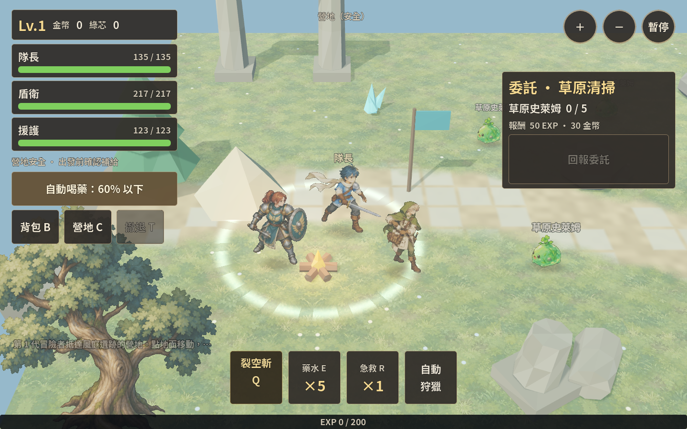
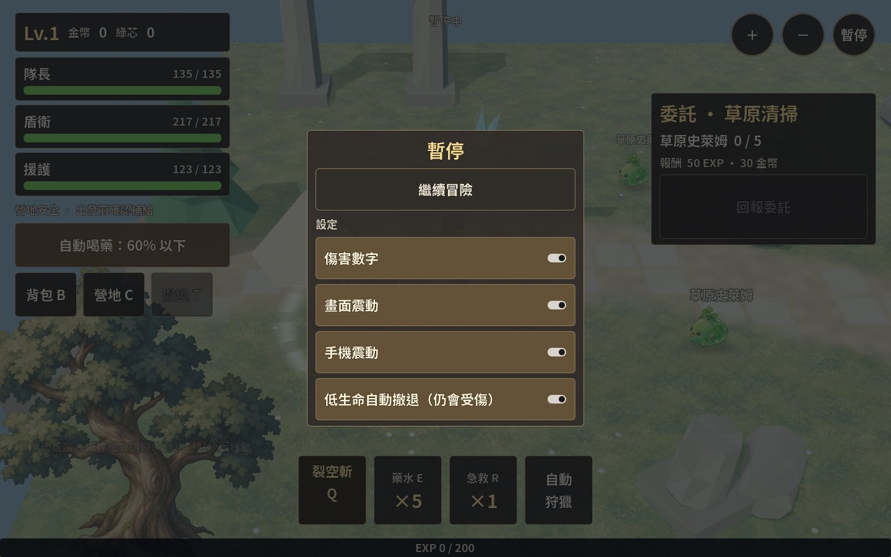
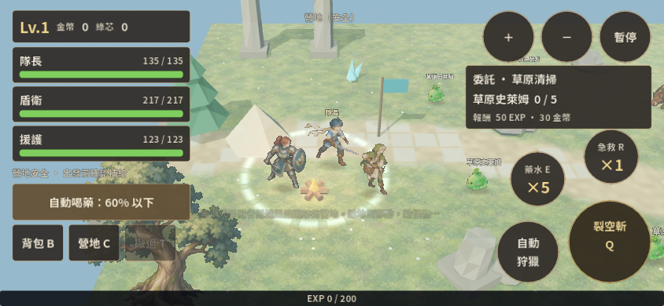
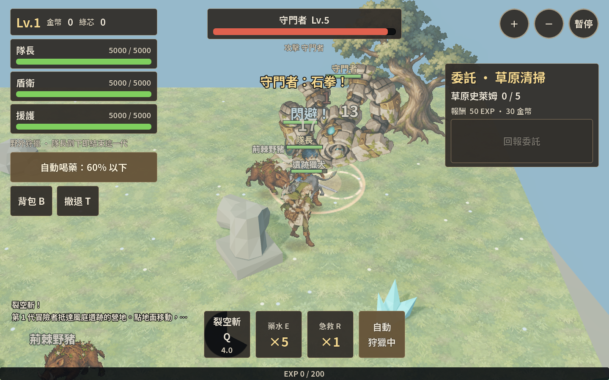

# 2026-10-26：功能完善與手繪素材接入

延續 [10-25 的改善](polish-2026-10-25.md)，依使用者最新指示，由 **GPT-6 Luna／max reasoning** 工作者透過內建 `image_gen` 產圖，主 session 負責功能、選圖、接入與驗收。Luna 是產圖工作的控制模型；沒有聲稱底層圖像生成模型就是 Luna。未 commit、未發布外部網站。

## 目前可玩的內容

- 桌機／手機橫向同一份遠征：三人隊伍、點選追打與移動、自動狩獵、補給、委託、裝備比較、技能與連招、撤退、永久死亡與下一代。
- **設定保存**：傷害數字、震屏、震動與低生命自動撤退存於 Profile，重開及跨世代繼續使用。暫停頁可操作；缺少舊設定或值損壞時使用預設。
- **資料驗證**：進入 Run／Profile 建構前檢查容器與巢狀資料，包括物品數量、裝備模板、配裝引用、任務、技能與倉庫。無效執行狀態拒絕寫入；壞主檔保留原始內容為 `.rejected`。
- **恢復路徑**：依序驗證主檔、`.old`、`.bak`、`.bak.old`、`.tmp`，涵蓋 AtomicFile fallback rename 中斷；死亡 journal 保存與重試延續前一輪修正。
- **風險可見**：安全營地、藥水不足、低生命及撤退倒數會顯示在隊伍欄下方。自動撤退仍有延遲與承傷，不保證存活。

## 美術採用結果

仍為固定俯角的 **3D 地圖＋2D 手繪 billboard**，不是將地圖改成單張背景。參考《救世者之樹》電腦版的手繪材質與資訊分區；材質語彙延續 Skybound 原創角色。

| 素材 | 結果 | 遊戲中的表現 |
|---|---|---|
| 守門者 | 採用 | `gatekeeper_illustrated.tscn`、專用 sheet；原地圖中的 Boss instance 已替換。預警／命中事件控制蓄力與震動形變，倒下仍用 dissolve。只有一張造型圖，沒有冒充完整多幀動作。 |
| 草地 | 採用 | 既有地形 shader 混合手繪 albedo；路徑、石板、3D 幾何保留。鏡像 UV 取樣消除原圖對邊不一致造成的拼接色差。 |
| 橡樹 | 採用 | 儲存為 `oak_illustrated.tscn`，場景裡的橡樹 instance 已替換；保留原樹位、縮放與阻擋半徑。樹遮住隊長時以 shader 網點裁切，模型不會消失或失去碰撞。 |
| 隊長攻擊蓄力 | 採用 | 技能施放期間顯示；持續時間由 domain `cast_ms` 事件提供，包含連招縮短的詠唱。暫停凍結。 |
| 隊長攻擊命中 | 採用 | 普攻使用命中幀；技能詠唱結束後切到命中幀。普攻原規則是立即結算，因此不在命中之後補播蓄力。 |
| 跑步 A/B 與額外修正 A | 未採用 | 不同幀的負重腳／握劍手未達一致性要求。完整候選與原因保留；遊戲沿用原有已驗證步態，沒有把兩張同腳姿勢當成左右腳循環。 |

完整來源與生成限制見 [Luna 產圖報告](release-evidence/2026-10-26/luna-art-report.md)。原圖輸出為 1254×1254，並未遵守 prompt 要求的 1024；接入依實際尺寸處理。部分原圖仍有彩色細邊；保留原始資料，製作版以可見 alpha 定位、額外留白及 mipmap 減少雜點／閃爍，沒有宣稱原圖完全無瑕。

## 可編輯場景與資源

| 路徑 | 可調整 |
|---|---|
| `scenes/field.tscn` | 地圖物件、出生點、鏡頭距離、Ground 的 `painted_grass_mix` 與 `texture_world_scale`。 |
| `scenes/actors/gatekeeper_illustrated.tscn` | Boss sheet、身高、名牌、血條；外觀與戰鬥數值分開。 |
| `scenes/props/oak_illustrated.tscn` | 樹高、block_radius、shader 遮擋參數；樹位與縮放在 field instance。 |
| `resources/sheets/leader_polish.tres` | 動畫格、每格 ticks；field 引用外部資源，避免留著舊的嵌入副本。 |
| `resources/sheets/gatekeeper.tres` | Boss 實際使用的規格與腳底線；與 sprite 測試檢查的是同一份。 |
| `ui/hud.tscn`、`ui/theme.tres` | 桌機／手機 HUD、設定頁、字級、底色與間距。 |

新圖的素材 atlas 與場景由 `tools/import_polish_art.gd` 製作，儲存後就是來源；執行／匯入遊戲不會自動重建。打包時保留 node owner、場景 instance 與 node 數量並重新載入檢查。隊長 cell 擴到 576，圖集 4032×576，讓展開的劍放得下而不單獨縮小身體。待機／倒下與原步態保留原有像素尺度。

## 製作工具操作

```text
Luna 原圖 → 主審選用 → atlas／外部資源 → 儲存 scene
        → headless 測試 → Web 匯出 → 瀏覽器檢查
```

```bash
# 在遊戲根目錄；重新製作前先檢查並保留人工修改的 diff
# 首次生成新資源，--activate 將通過的素材接入 field
# 已存在的製作成果預設保留；--replace 才重建
# --new-walk 是另一次選圖後才能使用的 opt-in，目前不要使用
godot --headless --path . --script res://tools/import_polish_art.gd -- --activate
godot --headless --editor --path . --quit
# 新 atlas 首次產生後，匯入一次再啟用其外部 sheet
godot --headless --path . --script res://tools/import_polish_art.gd -- --activate
```

`Image.load_from_file` 只在這支製作工具中用於讀取原畫與打包，工具排除於正式匯出；runtime 使用匯入的 Texture／`.res`。原始生成 PNG 有 workspace 副本，正式匯出排除未採用的角色候選與備存原畫。保留 `art_src/polish-v2/` 的原圖與實際使用於 `assets/`／`resources/` 的製作成果。

## 驗證與範圍

- Godot 4.7 的 `save`、`field:60`、`text`、`sprites`、`battle`、`skills`、`camp`、`run` 共 8 組 PASS。
- 額外驗證：nested schema 損壞、未知裝備、`.old` 恢復、壞 JSON 原文保留、偏好設定 round-trip、詠唱期間／暫停／命中切換，以及實際 field instance 引用正確 atlas。
- 素材第一次接入曾因低 alpha 雜點造成腳底判斷偏移；以可見像素製作獨立圖集後，Boss 及隊長 sheet 都通過 SpriteCheck。
- Web release 匯出、IDBFS 修補及 Chromium 啟動／暫停／1440×900→844×390 resize 檢查通過；畫面與報告存於本節同目錄的 release-evidence。
- 不包含 Android/iOS 實機 FPS、安全區、Safari、長時間記憶體與商業玩家試玩驗收。部分低多邊形松樹、遺跡與道具仍保留；這次是手繪主體／材質的接入，不是整個世界所有資產都已重製。

## 畫面與成品









- [瀏覽器報告](release-evidence/2026-10-26/browser-report.json)、[Web 匯出記錄](release-evidence/2026-10-26/web-build.log)。瀏覽器未發現 JavaScript／GDScript／載入／shader 編譯錯誤。
- Web 成品：`build/web/`；本機可用 HTTP server 預覽。壓縮包：`build/skybound-blades-web.zip`（約 20 MiB，含引擎）。PCK 約 10.43 MB；尺寸統計由 build 工具產出，未量測行動網路下載時間。
- 最終八組測試 log：`/tmp/godot-tests.pTcH7X`；外部資源引用修正後 `field`／`sprites` 再跑通過：`/tmp/godot-tests.lYIhEp`。第一次使用隔離 XDG_DATA_HOME 匯出時找不到共用模板，改由正常模板位置讀取後成功；TCP listen 訊息為 sandbox editor 工具限制，未造成匯出／瀏覽器啟動失敗。
- 本機短時截圖工具退出仍有 2 個 ObjectDB instance warning；這不等於正式 Web runtime 已發現同樣洩漏，也不當成長時間記憶體驗收通過。
