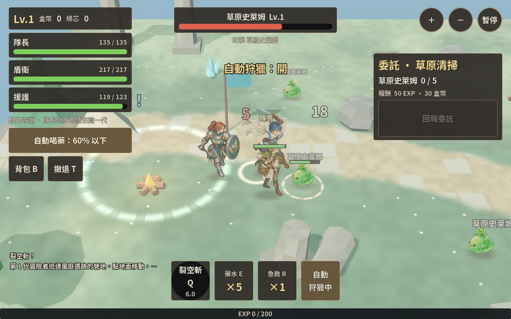
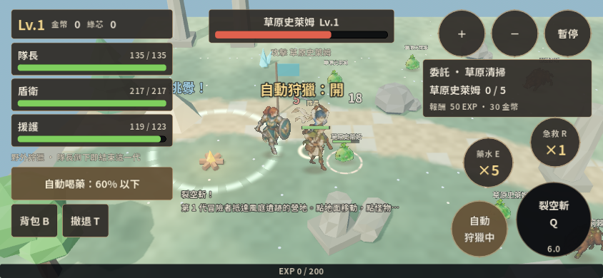
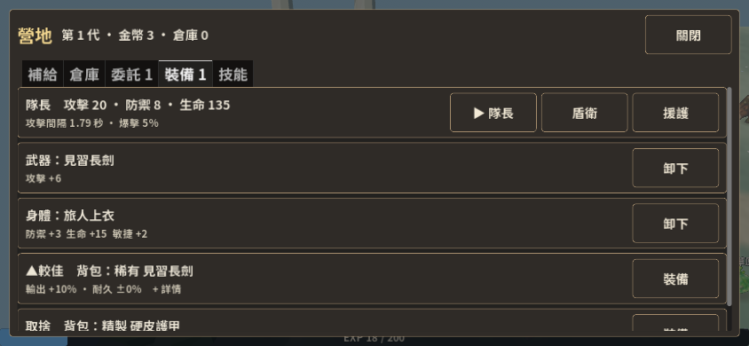

# Skybound：遠征可靠性與 PC 手繪 RPG 呈現調整

2026-10-25。依使用者要求，同步優化產圖 prompt、功能和遊戲美術展現，加入《救世者之樹》電腦版的風格與 layout 參考。本輪沒有 commit。

## 已落地

### 功能

- 死亡保存先提交含 Profile 快照的 tombstone，再推進記憶中的世代／紀念碑與主檔。journal 寫入失敗時不開始下一代，保留待提交狀態。
- 戰敗畫面仍會每 5 秒重試失敗的保存；玩家按下一代時也先確認保存成功。既有做法只在戰鬥進行時倒數，死亡畫面會失去重試機會。
- journal 成功、主檔尚未更新便中斷時，讀回被標記死亡的舊 Run，能一併恢復紀念碑、倉庫及下一世代，避免只刪除 Run 卻沿用舊世代 ID。
- HUD 顯示遠征狀態：營地安全、藥水用盡、低生命、撤退剩餘秒數與撤退期間仍會受傷。這是現有規則的可見化，不是自動模式保證存活。
- 補齊「詳情」圖示缺字：使用內附字型支援的 `+`。

工作開始前，工作樹已存在連招保留、冷卻換算、基礎 schema／備份檢查及手機營地放大等修正。本輪保留並回歸這些修改，沒有把它們全部算作此次新增。

### 畫面與 layout

參考 [PC 官方 UI guide](https://treeofsavior.com/page/guide/view.php?n=6) 的基本介面圖；該圖展示角色資訊、目標資訊、地圖、快捷列和訊息區。本輪採用其資訊分區思路，沒有新增多人聊天、商城或無作用的 UI 裝飾。

```text
桌機
┌────────────┬────────────────┬──────────────┐
│ 隊伍／資源 │ 目標／生命     │ 縮放／暫停   │
│ 遠征狀態   │                │ 任務追蹤     │
│ 背包／撤退 │    可視戰場    │              │
│            │                │              │
│ 戰鬥訊息   │ 技能／補給列   │              │
└────────────┴── 經驗進度 ────┴──────────────┘
手機：保留右側觸控配置，營地使用接近全螢幕的分頁面板。
```

- 桌機隊伍欄縮窄，技能、藥水、急救與自動狩獵改成底部中央四格；縮放／暫停縮小，將中央視野留給戰鬥。
- 深褐半透明面板、細黃銅邊、象牙字色與較輕的文字描邊。這是可編輯 Theme 的第一層呈現，不是已完成手繪 UI 貼圖。
- 草地改成低彩度灰綠／鼠尾草綠，路面與石板採暖石色；鏡頭起始距離 18，讓角色和場景關係更清楚。材質數值存於 scene，光照／幾何仍為既有 3D 場景。
- 手機切換時會保存並還原桌機 anchors、offsets 與按鈕最小尺寸；不把桌機四格列硬縮到手機。

### 圖片工作流程

[七份可直接用的 opt image prompt](assets/prompts-v2/README.md)：守門者、隊長跑步 A/B、攻擊蓄力／命中，以及補充草地材質與橡樹。

移除「姿勢完全不變但改成跑步」等矛盾；以實際隊長定稿而非文字指定的 3 頭身鎖定身份。動作稿改鎖頭大小／骨架／鏡頭／腳底定位，允許劍與披巾改變外框；手繪材質限制在形體內，避免整張紙色或雜訊濾鏡。

`tools/pack_sprites.py` 支援原生透明 RGBA，保留半透明邊緣與角色原色；只有舊洋紅圖才載入外部 `forge_matte`。可用 `SPRITE_FORGE_SHARED` 指向既有模組位置，缺少工具時回報明確原因。

**依使用者選擇，本輪只交付 prompt，沒有執行 AI 產圖、重打包圖集或替換核准素材。** 守門者仍是現有石像，樹仍是低多邊形；完整手繪環境需要回收新圖、建立 prop scene 與遮擋驗收。

## 驗證

- Godot 4.7：`save`、`field:60`、`skills`、`run`、`camp`、`battle`、`text`、`sprites` 最終相關檢查均 PASS。新增 journal 中斷恢復、死亡寫入失敗重試、阻擋下一代、風險提示測試。
- 首輪 `text` 發現既有詳情箭頭缺字；修正後重跑通過。Python 的 2 項 alpha／空白幀測試通過（需 Pillow；本輪以 uv 隔離工具環境執行）。
- `.tscn` 由 Godot `PackedScene.pack()`／`ResourceSaver.save()` 儲存，重新載入檢查 node 數量與 HUD／角色／營地子 scene instance 保留；headless 匯入與整合測試通過。
- 截圖：1440×900 桌機戰鬥、844×390 手機營地與戰鬥。使用隔離存檔、Xvfb 與軟體繪圖；不宣稱手機實機 FPS、Safari／安全區或正式 Web export 已驗收。
- 既有多個 suite 有故意失敗的儲存／JSON 案例；檢查結果以 assertions 為準，不將預期錯誤訊息宣稱為全 log 無 ERROR。

重跑：

```bash
# 從 source repository root
TEST_TIMEOUT=120 prototypes/godot-kit/tools/run_tests.sh \
  prototypes/skybound-blades save field:60 skills run camp battle text sprites
uv run --with pillow python prototypes/skybound-blades/tests/test_pack_sprites.py
```

## 編輯位置與後續邊界

- `ui/hud.tscn`：桌機 TopLeft、TopRight、ActionCluster、ExpeditionStatus；`ui/theme.tres`：字色、邊框、底色。
- `scenes/field.tscn`：根節點 `camera_distance`、Ground 的六個 shader 色彩；手機規則仍在 field 的既有 export 與 hud compact 設定。
- `game/field.gd`：死亡重試協調、狀態提示；`domain/save_service.gd`：死亡 journal 恢復；不修改共用 kit 副本。
- 本輪沒有新增樓層、職業、養成貨幣或離線收益。下一個內容切片應仍以一層遠征的決策品質為目標。
- journal 不是跨檔案資料庫交易：作業系統若連 journal 也無法寫入，關閉程式前只能提示並重試；尚未涵蓋所有 storage 損壞／未知 ID schema 案例，不宣稱儲存已無任何風險。

## 本輪畫面







手機戰鬥截圖工具退出時有 2 個 ObjectDB instance 未釋放的 warning；沒有 script error。這仍需在獨立的生命週期檢查中追蹤，不把本輪短時截圖視為長時間記憶體驗收。
